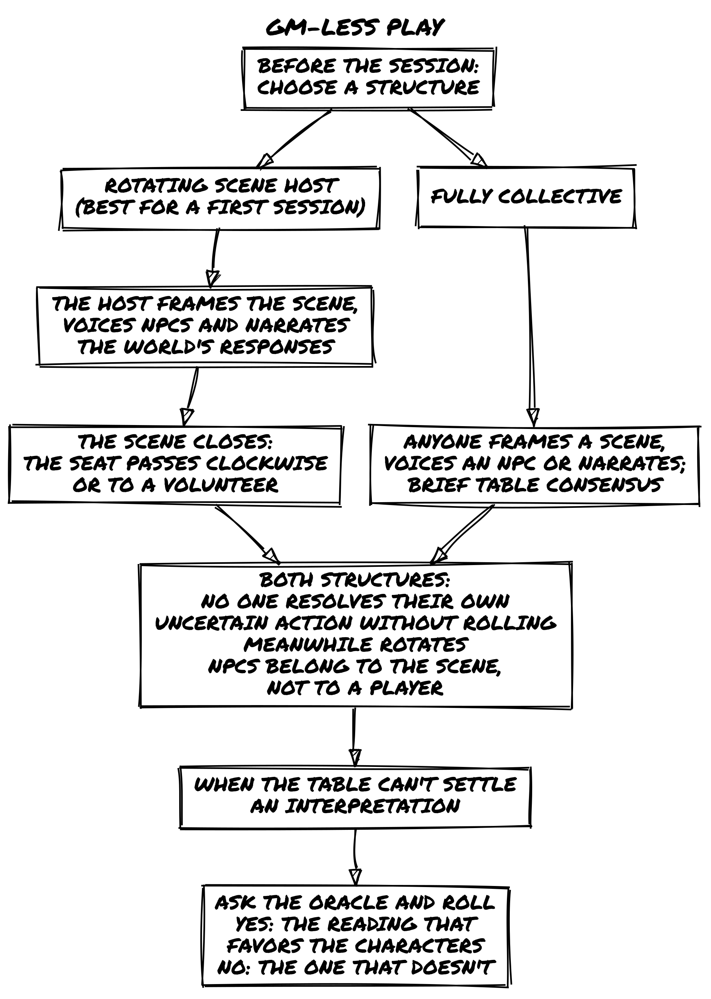
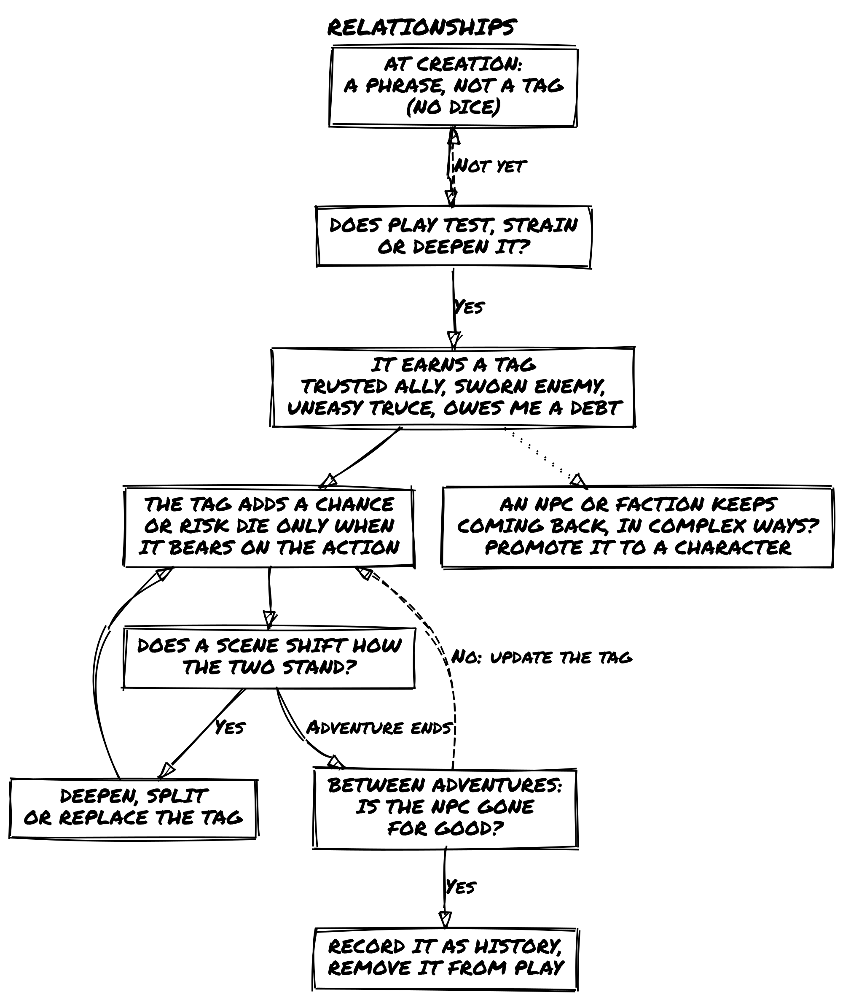
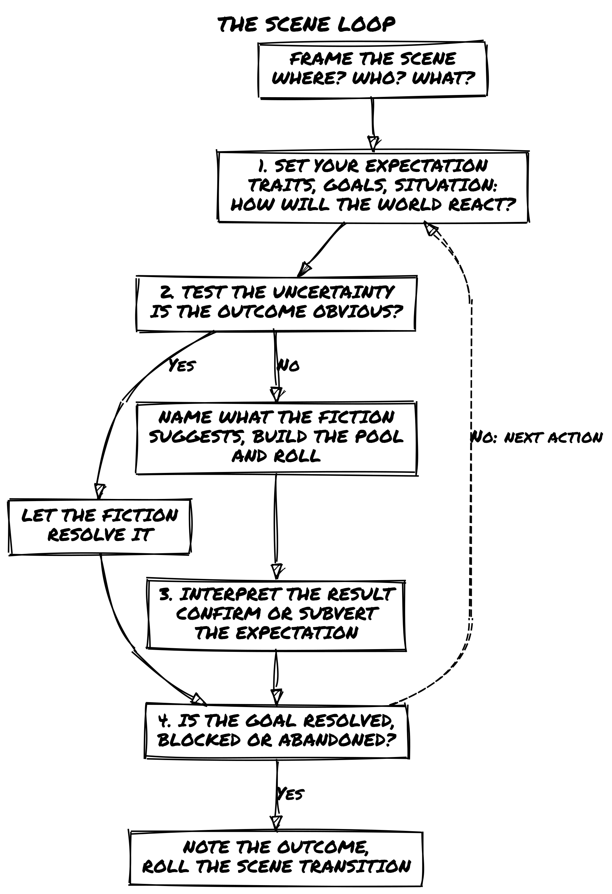
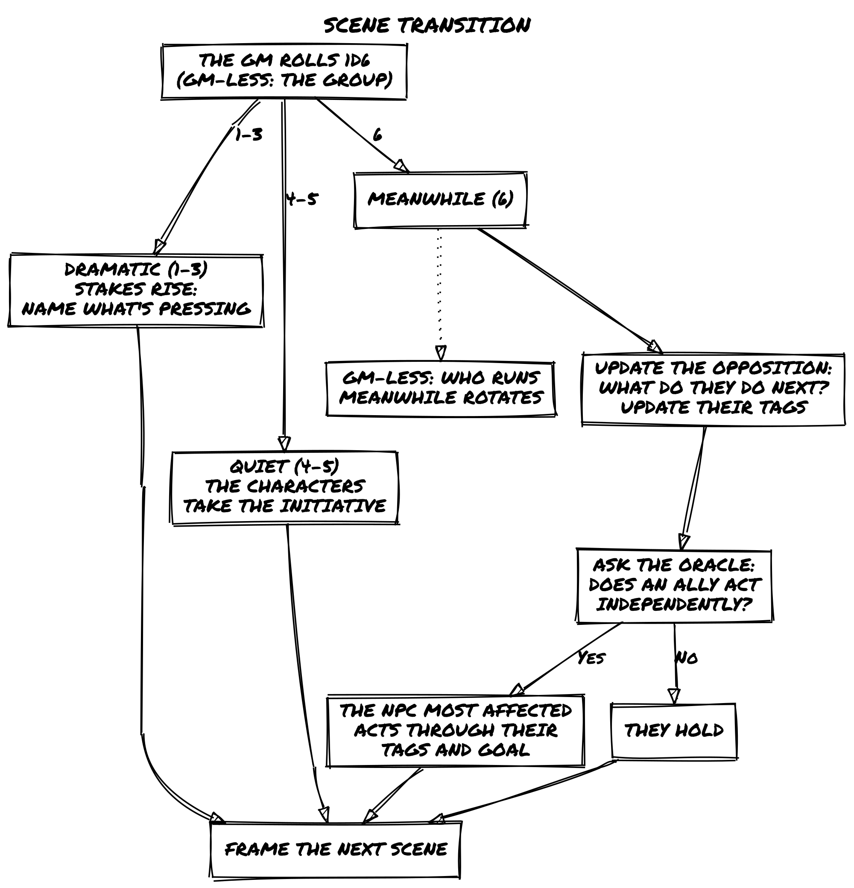
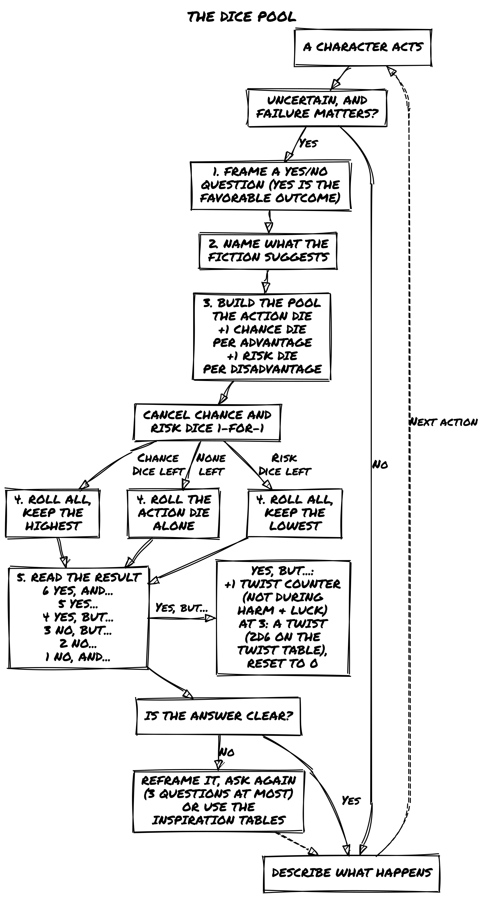
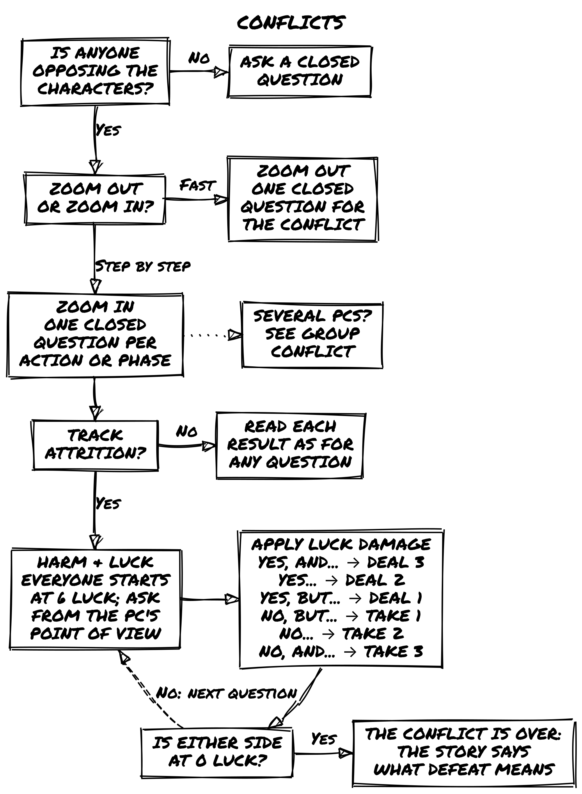
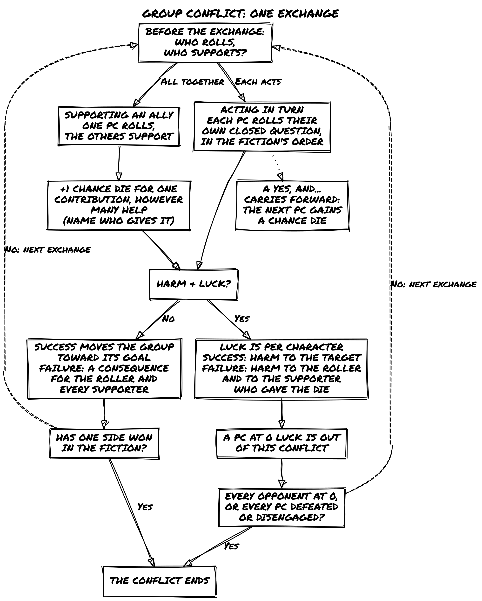
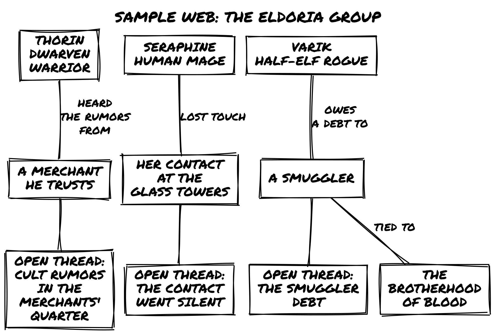

# Ensemble 2e
Roberto Bisceglie
2026-11-12

# Introduction

*Ensemble* and *Loner* are built on the same foundation: the same
Oracle, the same Tags, the same six outcomes. *Ensemble* brings that
foundation to the table for two or more players. You play characters in
a fictional world, decide what they do, and discover what happens
together. The story emerges from your choices, your dice, and the
consequences that follow.

The game is built on one core principle: **fiction precedes mechanics.**
You describe what your character does. The world reacts. Dice come in
only when the outcome is uncertain or dangerous. Everything else is
conversation. That makes *Ensemble* a **fiction engine**: every rule
exists to move the fiction forward. If a rule isn’t doing that, it isn’t
here.

Built on *Freeform Universal (FU)* by Nathan Russell, it reworks and
expands FU’s concepts while staying true to its minimalist, flexible
spirit.

*Ensemble* follows four design principles:

1.  **Portable.** All you need is a handful of six-sided dice and
    something to write with.
2.  **Rules-Light.** One core mechanic covers almost everything. You can
    learn it in minutes.
3.  **Tag-Based.** Characters, places, and things are described in
    words, not numbers.
4.  **Emergent.** No pre-written plot. Every session generates its own
    story.

## How Ensemble Is Different

Most lightweight RPGs give you either a GM-heavy structure or a fully
procedural oracle. *Ensemble* sits between them. In Classic mode, a GM
shapes the world and drives the fiction. In GM-less mode, the group
shares that responsibility and the Oracle fills the gaps. Either way,
the same dice pool and Tag system handles everything.

*Ensemble* and *Loner* share Chance and Risk dice, Tags, and the same
six-outcome resolution table. The main difference is the dice pool
procedure. See the callout below.

> **For Loner Players: The Dice Pool**
>
> *Ensemble* and *Loner* share the same six outcomes, from *Yes, and…*
> to *No, and…,* but reach them differently. In *Loner*, you roll one
> Chance Die and one Risk Die and compare them. In *Ensemble*, you build
> a pool: one **Action Die** plus **Chance Dice** (advantages) and
> **Risk Dice** (disadvantages). Cancel them 1-for-1, then roll the pool
> and keep the highest result if Chance dice remain, or the lowest if
> Risk dice remain. The outcomes map identically. The feel is different:
> Ensemble’s pool makes advantage and disadvantage physically present on
> the table. Unlike *Loner*, *Ensemble* does not cap the pool at two
> dice of each type: pool size is limited by honest fictional
> justification. You can use *Loner* Adventure Packs and characters with
> a few adjustments, listed below.

> **Using Loner Adventure Packs and Characters**
>
> Loner Adventure Packs, NPCs, and character sheets carry over with
> these adjustments:
>
> - **Dice:** Replace Loner’s Chance Die + Risk Die comparison with
>   Ensemble’s dice pool. Tags marked as advantages become Chance Dice;
>   disadvantages become Risk Dice.
> - **Twist Counter:** The counter and its threshold of 3 carry over,
>   but use Ensemble’s trigger: every *Yes, but…* result adds 1, not
>   just doubles.
> - **Harm & Luck:** Works as in Loner. Every character, PC or NPC,
>   starts each conflict at 6 Luck.
>
> Oracle tables, setting material, Tags, and character traits require no
> changes.

## Principles of Play

- **Fiction precedes mechanics.** Stay in the fiction before reaching
  for dice. The fiction triggers the roll, not the other way around.
- **The setting determines what’s possible.** The world suggests and
  limits what characters can do. A jungle ruin implies danger as surely
  as any written rule.
- **Roll only when outcomes are uncertain and failure matters.** You can
  try anything that fits the fiction. When the outcome is in doubt, dice
  resolve it.
- **Play honestly.** Trust each other. There’s no need to police moves
  or fudge results.
- **The game is conversation.** Listen and build on what others
  introduce. Pull their contributions into the scene.
- **Play to discover what happens.** Enter without a fixed script. No
  one, not even the GM, knows how it ends.

## Game Materials

- **Six-sided dice (d6):** A handful in three colors. One color is the
  **Action Die** (one per player). The others serve as **Chance Dice**
  (advantages) and **Risk Dice** (disadvantages). Ideally each player
  has one Action Die, six Chance Dice, and six Risk Dice.
- **Character sheets**, writing materials, and index cards or sticky
  notes for tracking Tags.

That’s it. No special components, no rulebook to memorize between
sessions.

## Modes of Play

- **Classic:** One player is the Game Master (GM), managing the world
  and all NPCs. The others each play a character. **This is the default
  mode for all examples in this book.**
- **GM-less:** No GM. Players share narrative authority and use the
  Oracle to drive the story.
- **Solo:** For solo play, see
  [***Loner***](https://loner.zotiquestgames.com/), a separate
  standalone game built on the same foundation as *Ensemble*. No
  purchase of either is required to play the other.

## Roles

### Players

- Decide what your character says and does.
- Give them a distinct personality.
- Ask questions to explore the world.
- Collaborate. Don’t use “it’s what my character would do” to wreck the
  fun.
- Listen and build on others’ ideas.

### Game Master

The GM is a player with additional responsibilities:

- Portray the setting and all NPCs.
- Present interesting challenges and obstacles.
- Clearly describe risks and potential consequences before characters
  act.
- Ensure everyone understands the scene and has a chance to contribute.
- Be a fan of the characters: play to see them do remarkable things, not
  to defeat them.
- Listen and build player contributions into the fiction.

## Safety Tools

Some themes can be intense or emotionally heavy. If a scene makes you
uncomfortable, say so. Rewind, reframe, or skip. The game is a tool for
stories you want to tell. Nothing here requires anyone to push through
something that doesn’t feel right.

Before play begins, use
[CATS](https://proleary.com/2016/04/25/the-cats-method-a-story-telling-game-opening-ritual/)
(Concept, Aim, Tone, Subject Matter) to align everyone’s expectations.
During play, use [Script Change](https://thoughty.itch.io/script-change)
to manage content in the moment.

## GM-less Play

In GM-less mode, no single player holds the GM role. Narrative authority
is shared: the group collectively frames scenes, voices NPCs, and
interprets Oracle results. Two structures work equally well. Choose one
before the session begins.

**Rotating scene host.** One player takes the host seat for each scene.
They frame the scene (Where, Who, What), voice NPCs, and narrate the
world’s responses to Oracle results. After the scene closes, the seat
passes to the next player, clockwise, or whoever volunteers. The host
interprets Oracle results for the world; each player interprets results
for their own character’s actions.

**Fully collective.** No designated host. Any player can frame a scene,
voice an NPC, or narrate the world’s response. Decisions are made by
brief table consensus. If consensus breaks down on an interpretation,
ask the Oracle: “Does the more favorable reading hold?” Roll and read
normally.

Both structures follow the same rules:

- **No player resolves their own character’s uncertain action without
  rolling.** The Oracle’s role doesn’t change.
- **Meanwhile rotates.** The player who updates the opposition and asks
  the ally question changes each time Meanwhile triggers.
- **NPCs belong to the scene, not a player.** An NPC established in one
  scene can be voiced by anyone in the next.
- **Disputes go to the Oracle.** If an interpretation can’t be settled
  by brief consensus, ask a closed question and roll. Yes = the
  interpretation that favors the characters. No = the one that doesn’t.



# Playing the Game

## Key Concepts

### Fictional Positioning

Fictional positioning is the set of circumstances defining your
character’s situation: where they are, what they have, who they know,
what they’ve done. It determines what’s possible. If you’ve tripped a
troll and stand ready to strike, that advantage comes from positioning.
If you’re at a cliff with no rope, that limitation does too.

In practice: always keep in mind where characters are, what they’re
doing, and how the environment, objects, and other characters interact
with them. The fiction is always the first question.

### Everything is a Character

PCs, NPCs, antagonists, creatures, organizations, vehicles, artifacts:
all are defined the same way, with Tags. A cursed sword has traits and a
history just like a person does. This keeps the system consistent and
makes every element in the world a potential source of fictional change.

Not everything needs a full character sheet. A simple rule of thumb:

- **If it matters once**, keep it as plain tags.
- **If it keeps showing up or pushes back against the characters**,
  promote it to a character and play it by the same rules.

A safehouse can be three tags: *Hidden Entrance*, *Reinforced Door*,
*Nosy Neighbors*. If that safehouse becomes the campaign’s recurring HQ
that keeps getting threatened, give it a sheet. The same logic applies
to factions, vehicles, and cursed locations: they start as tags and
graduate to characters when the fiction demands it.

## Example Campaign

The examples throughout this book use the following setting and
characters. When you see Fred, Luke, Mark, Sophia, Matt, and Claire at
the table, this is who they are.

### Setting: Eldoria

Eldoria is a vast fantasy realm where ancient magic and epic adventure
are commonplace. High mountains hide dragons, impenetrable forests house
elves, and deep caverns guard forgotten secrets. Independent
city-states, warring kingdoms, and unexplored wildlands offer endless
opportunities for adventure.

Magic permeates Eldoria, shaping its history, society, and politics.
Mages hold power but also face suspicion. Ancient artifacts wait to be
discovered, and secret cults seek to revive forgotten deities. Beyond
the cities lie the Wildlands: zones of danger and wonder, the final
frontier for those seeking to prove their worth.

### Players and Characters

**Luke plays Lirael, the Elven Archer.** A wood elf with a light step
and unerring eye, seeking adventure beyond her native forest.

**Mark plays Thorin, the Dwarven Warrior.** Descendant of a warrior
line, wielding axe and shield in search of honor and redemption.

**Sophia plays Seraphine, the Human Mage.** A promising mage seeking
arcane secrets and forgotten artifacts.

**Matt plays Varik, the Half-Elf Rogue.** Charisma and shadow skills in
equal measure, seeking redemption for past sins.

**Claire plays Aelwyn, the Druidic Healer.** A pure-hearted druid sworn
to protect Eldoria, using healing arts and natural magic.

**Fred is the Game Master.** He guides the group through the wonders and
dangers of Eldoria.

## Choose a Setting

Before you create characters, agree on the world you’ll play in. This
can be a setting from a favorite book, film, or game; a genre you all
want to explore; or something built from the Adventure Maker tables at
the back of this book.

You don’t need a detailed world bible. A few evocative words that
capture the tone, the stakes, and the rough shape of the world are
enough to get started. “Political intrigue in a dying empire,” “dungeon
crawl in a cursed mountain,” “heist in a city of floating islands”: any
of these gives you enough to begin.

Agree on two or three things that are true about the setting: what’s
common, what’s rare, what kind of trouble characters typically find
themselves in. Then build characters for that world and let the rest
emerge from play.

> **📌 Example: Setting Agreement**
>
> Before the Eldoria campaign, the group agrees: magic is common but
> politically dangerous; the Wildlands are worth exploring but deadly;
> characters will be working outside established power structures.
> That’s enough. Everything else comes out during the sessions.

## How to Play

### Tags

Tags are concise labels that describe the fictional world and everything
in it. A short word or phrase, attached to a character, place, object,
or situation, identifying what matters about that thing right now.

Tags are qualitative, not quantitative. “Bow Mastery” doesn’t give +2 to
anything. It tells you what the character can do and, when it’s
relevant, adds a die to the pool. The fiction is always the first test:
a tag that isn’t relevant to the current moment doesn’t do anything,
even if it’s technically present.

There are three kinds of Tags:

#### Character Traits

Traits capture a character’s essence: concept, skills, frailties, goals,
motives, gear, and relationships once play has earned them a tag (see
Relationships). Like every tag, a trait adds a die to the pool only when
it bears on the action at hand.

> **Examples from Eldoria:**
>
> - **Knower of Eldoria:** Has vast knowledge of the lands and its
>   secrets.
> - **Master of Runes:** Can channel magic through ancient runes.
> - **Phobia of Dragons:** Terrified at the sight or mention of dragons.
> - **Redeem the Family:** Driven to restore his family’s honor.
> - **Ally of Wood Elves:** Has earned the trust of the forest elves.
> - **Flaming Sword:** A sword that engulfs itself in flames on command.

#### Details

Details describe the environment or a specific scene: atmosphere,
notable objects, conditions of a place. They change: character actions
can add, modify, or remove them.

> **Examples:**
>
> - **Filtered Light:** Sunlight filters through enchanted leaves that
>   change color with the seasons.
> - **Spice Aroma:** The air is thick with exotic spices from the market
>   stalls.
> - **Deep Echo:** Every sound in the caverns reverberates endlessly.
> - **Luminous Ice:** Ice formations reflect and diffuse light in
>   dazzling patterns.

#### Conditions

Conditions describe temporary physical, mental, or social states that
affect what a character can do. They are applied as consequences of
actions and removed through fictional means.

> **Examples:**
>
> - **Severely Wounded:** Can’t move quickly or perform demanding
>   physical actions.
> - **Terrified:** Difficulty concentrating; prone to irrational
>   decisions.
> - **Ostracized:** Has lost favor with a community, hindering social
>   interactions there.
> - **Cursed:** A magical affliction bringing specific impediments until
>   broken.

#### How Tags Affect Play

Tags describe what is true in the fiction. That fictional truth is what
licenses a roll at all. Before asking whether a tag grants a Chance Die
or Risk Die, ask whether the tag is relevant to this specific fictional
moment.

**Good use of Tags:**

- Lirael has **Bow Mastery** and is shooting from a prepared position:
  that’s a Chance Die.
- Varik has **Shadow Skills** and needs to move fast in a fight: that’s
  a Chance Die.
- The cave has the tag **Shifting Walls**: trying to navigate it quickly
  adds a Risk Die, even if the character has no relevant frailty.
- Thorin’s **Limp** hinders him in a chase but earns him sympathy from a
  wounded veteran NPC: the same tag works as a Risk Die in one scene and
  a Chance Die in another.
- Frailties apply in both directions. When a PC’s frailty is active in a
  moment, *Impulsive* in a negotiation or *Afraid of Heights* on a
  rooftop, it adds a Risk Die. When a player identifies and actively
  exploits an *NPC’s* frailty, pressuring a *Bound by Honor* guard by
  making the terms public or outpacing an *Overconfident* adversary’s
  assumptions, that earns a Chance Die. The question is always: who
  holds the better fictional position right now?

**What Tags are NOT:**

- A numerical rating. *+2 Strength* is not a Tag.
- A passive trait that never changes outcomes. *Nice Person* isn’t
  useful unless it actually affects what happens.

Think of Tags as **narrative signposts**: they describe things in a way
that directly affects the story.

### Characters

A character is defined by Tags. These traits make them unique and
provide advantages or disadvantages during play.

#### Creating a Character

- **Concept:** A phrase capturing who your character is. “Desert
  Explorer,” “Gentleman Rogue,” “Retired Space Smuggler.”

  > - Too broad: *Strong Fighter*, *Heroic Person*. They don’t suggest
  >   what the character actually does.
  > - Specific: *Cunning Bounty Hunter*, *Haunted Scholar*. Each implies
  >   a method, a burden, a way of moving through the world.

- **Skills (2):** Specific talents or abilities that grant narrative
  permission: they tell you what the character can actually do.

  > - Too vague: *Stealthy*, *Smart*. They don’t change what happens in
  >   play.
  > - Specific: *Shadow Walker*, *Tactician’s Mind*. They show how the
  >   character moves through the world.

- **Frailty (1):** A weakness, vulnerability, or complication. “Greedy,”
  “Hard of Hearing,” “Wanted by the Law.” When a Frailty bears directly
  on the situation, it adds a Risk Die to the pool. Like all Tags,
  context determines relevance: the same Frailty that hinders in one
  scene may help in another.

- **Motive:** What drives them, an instinct, belief, or attitude.
  “Always defend the weak.” “Knowledge is power.”

- **Goal:** A medium or long-term aspiration. “Redeem my family’s
  honor.” “Find the lost artifact.”

- **Relationships:** Write a short phrase for each tie to another PC or
  an NPC: “Thorin once saved my life.” “I run errands for the Merchant
  Guild.” These phrases are not tags yet: they say who matters to the
  character and add no dice. A relationship earns its tag in play. See
  Relationships below.

- **Gear:** Distinctive equipment. Items intrinsic to the concept plus
  two additional pieces. Only noteworthy items need listing; characters
  are assumed to carry standard gear for their role. Specialist gear can
  add Chance Dice when relevant.

> **Keep the sheet lean.** The sheet captures who this character is in
> any scene you’re likely to play, not everything they’re documented as
> being able to do. Two well-chosen Skills do more work than five
> overlapping ones. Ask: which tags make this character *specific* in
> the next scene? If a tag never bears on the situation, it wasn’t
> earning its place. Tags evolve through play; the sheet describes who
> the character is *now*, not the legend they might become.

> **Let Goal and Motive emerge from play.** The best Goals and Motives
> aren’t chosen from a list before the first scene; they come from the
> fiction itself. A Goal that forms in response to the opening situation
> has stakes that a pre-written one rarely carries. A Motive that
> connects to something that actually happened at the table has weight.
> If you start without them, that’s fine: frame the opening scene, see
> what the fiction makes true about these characters, and write down
> what emerges. The table usually knows within the first two scenes.

> **📌 Example: Lirael**
>
> - **Concept:** Wood Elf Archer
> - **Skills:** Bow Mastery, Silent Movement
> - **Frailty:** Bond with the Forest (weakens far from wooded areas)
> - **Goal:** Protect the ancient forests of Eldoria
> - **Motive:** Deep love for nature and wild places
> - **Relationships:** Ally of Forest Ents, Enemy of Treasure Hunters
> - **Gear:** Enchanted Longbow, Cloak of Leaves

#### Growth

Characters don’t advance by leveling up. They grow by living through the
story. Growth follows three principles:

1.  Your character becomes more complex, not simply stronger.
2.  Every change connects to something that happened in play.
3.  Growth can happen at any moment, not just between sessions.

In practice, this means Tags evolve. New traits appear, existing ones
shift, frailties deepen, relationships change. This approach is
sometimes called organic growth: character development that emerges from
the fiction rather than from accumulated experience points. Growth is
reflected directly in the character sheet as play proceeds. See also
Post-Game Character Growth in the Between Adventures chapter.

> **📌 Example: Organic Growth**
>
> After leading resistance against an illegal logging operation, Lirael
> gains the trait **Environmental Leadership** and her **Bow Mastery**
> evolves into **Guerrilla Strategist**, reflecting new tactics learned
> in the field. Her **Bond with the Forest** frailty deepens: she now
> feels physically weak in urban environments.

#### Converting a Background

If you already have a written background, extract the relevant Tags:

> Once, in the shadows of Gilden, lived a thief named Eryk, known as
> “Veiled Shadow.” A decade of thefts gave him an enviable reputation:
> he could disappear in a breath, and no lock resisted his touch. An old
> leg injury slowed him, a reminder of a trap barely escaped. He stole
> only from those who could afford to lose. His goal: enough wealth to
> retire where no enemy could find him.

> **Eryk’s Tags:**
>
> - **Concept:** Veiled Shadow, veteran thief and master of
>   disappearance.
> - **Skills:** Master of Shadows, Locksmith Artisan
> - **Frailty:** Limp, an old leg wound, a constant reminder of risk.
> - **Motive:** Steal from the rich to build a better life.
> - **Goal:** Gather enough wealth to retire safely.
> - **Relationships:** Theft Partner (PC), Old Enemy: a guard sworn to
>   capture him (NPC).
> - **Gear:** Lork’s Lockpicks, Shadow Cloak.

#### Creating NPCs

NPCs follow the same tag logic as PCs. Build only what the scene needs:

- **Walk-on NPCs** (one appearance, minor obstacle): a Concept tag and
  one relevant Skill. No sheet needed.
- **Named NPCs** (recurring, have agendas): Concept, one or two Skills,
  one Frailty. Add a current goal-tag and put them on the running list.
- **Factions and organizations** (take actions, have Luck): Concept, one
  or two Skills, one Frailty. Treat them as full characters when they
  start pushing back.

Every NPC starts a Harm & Luck conflict at 6 Luck, like the PCs, and
Luck resets when the conflict ends. Show how dangerous an opponent is
through its tags: a major antagonist brings Skills that apply to almost
every exchange, a minor threat brings few. A minor threat often needs no
Harm & Luck conflict at all: Zoom Out and resolve it with one question.
Lasting consequences land as tags, not reduced Luck.

### Relationships

Tags describe what a character is. They also describe what a
relationship has become.

When a connection with another PC or an NPC has been tested, strained,
or deepened through play, that relationship earns a tag. *Trusted Ally*,
*Sworn Enemy*, *Uneasy Truce*, *Owes Me a Debt*. These tags function
like any other: when they bear directly on the situation, they add a
Chance Die or Risk Die to the pool.

At creation, relationships are phrases, not tags. A relationship earns
its first tag the first time play tests, strains, or deepens it. From
then on it grows like any other tag: any scene that shifts how two
characters stand toward each other (a shared risk, a moment of trust, a
betrayal, a quiet exchange that changes everything) can deepen, split,
or replace it.

PC-to-PC relationships work the same way. If Thorin saved Varik’s life
in session two and they’ve been tight ever since, *Owes Thorin His Life*
is a real tag that could grant Varik a Chance Die when acting on
Thorin’s behalf, and could impose a Risk Die when acting against his
interests.

> **📌 Example: Earning a Relationship Tag**
>
> The group has been working with Sir Elric of Eldorhaven, a conflicted
> knight, for three sessions. In the fourth session, Elric shares
> information that puts him at serious personal risk to help them.
> Lirael’s player notes the relationship: she assigns the tag **Tested
> Alliance, Cautiously Trusted** to the bond between Lirael and Elric.
> From now on, when a scene involves asking Elric for help or
> information, that tag is in play.

#### When to Promote a Tag to a Character

Relationship tags and recurring NPCs can start as plain tags and
graduate when the fiction demands it, by the rule of thumb in Everything
is a Character.

An NPC who appears in two scenes as a tagged name (*Crooked Merchant*)
becomes a full character when the group starts interacting with them in
complex ways. A faction that was a tag on the world (*Brotherhood of
Blood*) becomes a character when it starts taking actions that need a
Concept, Skills, and Luck.



### Before Play

You don’t need hours of prep. A few notes before the first scene make
everything more grounded.

**Build a web of connections.** The NPCs named in your characters’
relationship phrases already exist: note each one with a name and a few
words on who they are. They’ll show up.

**Note important locations.** Places that might be revisited: a guild
hall, a ruin the group is heading toward, a city they left behind with
unfinished business.

**Track open threads.** Loose ends that haven’t resolved yet: a rumor
that went nowhere, a contact who didn’t show, a debt that hasn’t been
collected. A name and two words is enough.

These notes are starting points. As play develops, NPCs will change,
locations will be marked by what happened there, and open threads will
pull the story forward in unexpected directions.

### Scenes

A scene is a segment of play defined by a situation, place, or set of
characters: a beat where something moves, something is revealed, or a
character is seen more clearly.

#### Framing a Scene

Before the first dice are rolled, establish the scene’s conditions.
Answer three questions in plain terms:

- **Where** are the characters, and what does that place feel like right
  now?
- **Who** is present, or likely to become present?
- **What** do the characters intend to do here?

You don’t need to roll for any of this. Use what the fiction has
established: the previous scene’s outcome, updated NPC tags, the
transition that brought you here. If something is uncertain, ask the
Oracle one framing question before the scene begins. A framing question
must be about a fictional condition (what is already true about the
situation), not about what will happen. “Is the building still guarded?”
is a framing question. “Do we get inside?” is not; that belongs in the
scene itself.

Once you can answer all three, the scene is open. Start playing.

> **📌 Example: Framing a Scene**
>
> The group’s last scene ended with them fleeing the city gates on
> horseback, one step ahead of the city guard. Before anyone rolls, Fred
> frames the next scene:
>
> - **Where:** A dense pine forest, an hour’s ride from the city. Cold,
>   quiet, branches blocking the moon. The horses are winded.
> - **Who:** The five characters, no immediate pursuit visible, but
>   tracks in the mud show recent activity.
> - **What:** Find shelter before dawn and assess whether they’re still
>   being followed.
>
> All three conditions are set. The scene is open.

#### The Scene Loop



Every scene follows a natural rhythm:

1.  **Set your expectation.** What do the characters want to achieve in
    this scene? Look at their traits, goals, and the situation to
    determine what makes sense. How do you expect the world to react?
2.  **Test the uncertainty.** If an outcome isn’t obvious (or if
    overconfidence might tempt fate), resolve it with a closed question.
    Name what the fiction suggests before building the pool (see The
    Dice Pool Procedure). Use Tags to determine whether someone has a
    Chance Die or Risk Die advantage.
3.  **Interpret the result.** The dice confirm or subvert your
    expectations. How does this outcome reshape the scene? What new
    possibilities emerge?
4.  **Close and transition.** When the scene ends, note the outcome and
    roll the Scene Transition to establish what comes next.

At first, you may want to follow this structure deliberately. With
practice, it becomes second nature.

#### Types of Scenes

**Descriptive scenes** set atmosphere, reveal information, or explore
character without requiring dice. A journey, a rest, a flashback, a
conversation that reveals backstory.

> **Fred:** The dusty road winds through the valley, flanked by barley
> fields. In the distance, Kingshaven’s towers are wrapped in **morning
> mist**. Along the path, a temporary market buzzes with merchants
> selling **small magical artifacts**. An old man in rags staggers into
> the square, waving a **worn map** and shouting about a “curse looming
> over the city” before collapsing. **What do you do?**

**Action scenes** involve specific challenges requiring decisions and,
often, dice. Combat, tense negotiations, heists, chases.

These two labels describe a scene’s texture. The Scene Transition’s
Dramatic, Quiet, and Meanwhile types (described later in this chapter)
describe its register: who holds the initiative. The taxonomies overlap
without mapping exactly: a Quiet Scene is often descriptive, a Dramatic
Scene is usually an action scene, and a Meanwhile can be either.

> **Fred:** Twilight envelops the Moonwood. Brigands block the path.
> Lirael, the fading light heightens your senses. **What do you do?**
>
> **Luke (Lirael):** I use the twilight and my **Silent Movement** to
> find an elevated position for a surprise shot.
>
> **Mark (Thorin):** I advance directly, drawing their attention away
> from the others.
>
> **Sophia (Seraphine):** While Thorin holds them, I cast a confusion
> spell on the brigands behind him.
>
> **Matt (Varik):** I slip behind their lines to inspect their cart.

#### Asking Questions

Players ask questions to clarify the scene or introduce new elements.
This is how the world gets built at the table.

> **Luke (Lirael):** Is there any sign of how long the brigands have
> been here?
>
> **Fred:** The tracks are fresh. This camp was used recently.
>
> **Mark (Thorin):** Documents? Symbols? Anything indicating who sent
> them?
>
> **Fred:** A partially burned document with a seal. It looks like it
> belongs to a local noble.

#### When to Roll

Not every action needs dice. Roll when:

- **The outcome is uncertain:** it could go either way given the
  fiction.
- **Failure has consequence:** it shifts circumstances, not just causes
  a minor inconvenience.
- **A surprise would be welcome:** even when you’re fairly confident,
  sometimes the dice reveal what you didn’t plan.

Don’t roll when the outcome is obvious: if Varik has **Expert
Lockpicking** and the lock is a simple padlock, he opens it. If
Seraphine casts a light spell in a dark corridor with no opposition
present, the corridor is lit. Let the fiction do its work before you
reach for dice.

> **📌 Example: No Roll Needed**
>
> Lirael knows from two sessions of reconnaissance that the castle
> courtyard is empty at midnight. The GM agrees: she enters undetected
> without a roll, because the fiction supports it clearly.

> **📌 Example: Roll Called For**
>
> Varik tries to pick a lock while a patrol walks past twenty feet away.
> The outcome is uncertain and the consequences matter (getting caught
> would be significant). He rolls.

#### The First Scene

Start in the action. An in-medias-res opening, a conflict, a crisis, a
mystery already in motion, reveals character through pressure.

The GM can use the **5W+H method** to assemble a mission premise before
dropping into the action. Roll once on each column, or pick entries that
fit the tone you want. The six answers give you the bones of a
situation: **Who** is driving it, **What** needs to happen, **When** it
needs to happen, **Where** (or what) the target is, **Why** the
characters care, and **How** they get drawn in. Combine them, let them
contradict each other, and open the first scene in the middle of it.

###### 5W+H Mission Premise

| D6 | **Who?** | **What?** | **When?** | **Where?** | **Why?** | **How?** |
|:--:|:--:|:--:|:--:|:--:|:--:|:--:|
| 1 | Authority | Rescue | Tonight | Person | Aid | Chance encounter |
| 2 | Organization | Protection | Within days | Group | Fortune | Old connection |
| 3 | Ally | Exploitation | At a planned event | Treasure | Coercion | Rumor or message |
| 4 | Mentor | Exploration | Before it closes | Location | Impulse | Capture or threat |
| 5 | Help-seeker | Escape | After a change | McGuffin | Ambition | Mishap |
| 6 | Blackmailer | Pursuit | Right now | Confession | Revenge | Object delivered |

You can frame the mission first, then drop into the middle of it going
wrong:

> **Fred:** Night wraps Vaelora. The central square swarms with
> screaming goblins. A building burns. Lirael, you’re on the rooftops,
> just out of a duel. Thorin, Seraphine, Varik, Aelwyn: you’re
> surrounded in the square, backs to the monument. **What do you do?**

#### Closing a Scene

A scene ends when one of the following is true:

- The characters’ immediate goal has been **resolved**: achieved or
  definitively failed.
- The goal has been **blocked**: circumstances have made it impossible
  to pursue further in this scene.
- The characters **abandon** the goal and commit to a different course
  of action.

When any of these conditions is met, stop asking Oracle questions. Note
the outcome, then move to the next scene.

If none of the three conditions feel clearly met, ask: “Has this scene
run its course?” A Yes of any kind closes it. A No means there’s still
something worth pursuing here. Use this as a last resort, not a routine
check.

> **📌 Example: Closing a Scene**
>
> The group is interrogating a merchant about a shipment of stolen
> artifacts. After three questions, the merchant refuses further
> cooperation and his bodyguards appear at the door. The goal of
> extracting information is blocked. The scene closes. Note what you
> learned and open the next scene.

#### Scene Transition

At the end of a scene, the GM (or in GM-less mode, the group) rolls
**1d6** to establish the shape of what comes next.

###### Scene Transition

| D6 | Scene Type | What It Means |
|:--:|:--:|:---|
| 1-3 | **Dramatic Scene** | Stakes rise. New obstacles, dangers, or complications arrive. |
| 4-5 | **Quiet Scene** | Pressure lifts briefly. Characters take the initiative. |
| 6 | **Meanwhile** | The world acts while the characters are offstage. |

**Dramatic Scene (1-3):** Something external has moved. A threat has
advanced, a complication has surfaced, a plan has begun to unravel. The
characters are responding, not initiating. Name what’s pressing before
the scene opens.

**Quiet Scene (4-5):** The characters have the initiative. Rest and
recover, plan and prepare, gather information, deepen a relationship.
The Oracle is still consulted, but the questions are about things the
characters initiate, not crises landing on them. When pressure enters a
Quiet Scene and the fiction tips toward urgency, that moment is a
turning point: the scene’s register has shifted. Close the scene there
and open a Dramatic Scene from that point.

**Meanwhile (6):** The world doesn’t pause. Follow both steps:

1.  **Update the opposition.** Cut to whoever holds power over the
    situation: the antagonist, a rival, a faction. Ask what they do
    next. Update their tags to reflect their action. If they were
    *Planning the Attack*, they are now *Ready to Strike*. These updated
    tags are in play the moment the story returns to the characters.

2.  **Ask the Oracle:** *“Does an ally act independently?”* On a Yes of
    any kind, pick the NPC most affected by recent events and interpret
    their action through their current tags and goal. On a No, they
    hold.

> **📌 Example: Meanwhile**
>
> The group has just exposed a corrupt city official and scattered into
> the streets. Fred rolls a 6: Meanwhile. He cuts to Lord Varron
> Darkwill, currently tagged *Searching for the Source of the Leak*.
> Varron makes a move: the tag updates to *Has Identified the Party*.
> Fred then asks the Oracle: “Does an ally act independently?” Yes, but:
> Seraphine’s contact at the mage guild has started moving to warn her,
> but is being followed. The characters don’t know any of this yet. When
> the next scene opens, the world is already ahead of them.



### Resolving Actions

When an action’s outcome is uncertain or dangerous, resolve it with a
closed question.

#### The Dice Pool Procedure

**1. Frame the question.** State what the character is trying to do as a
Yes/No question. Always phrase it so **Yes** is the favorable outcome.

> “Do I steal the amulet without being noticed?” Not: “Does the goblin
> catch me stealing?”

**2. Name what the fiction suggests.** Before any dice are picked up,
say what the current situation implies. Not a prediction, just a shared
read of the fiction. “This looks like a Yes to me.” “I’d expect a No
here.” If the table disagrees, settle it in one sentence, then move on.
This step keeps the roll honest: it makes the fiction’s weight visible
before Tags and dice have their say.

**3. Build the dice pool.**

- Start with the **Action Die** (always rolled).
- Add one **Chance Die** for each Tag providing an advantage.
- Add one **Risk Die** for each Tag creating a disadvantage.
- Chance and Risk Dice **cancel each other out** 1-for-1. You never roll
  both types together.

Each relevant advantage Tag adds one Chance Die; each relevant
disadvantage Tag adds one Risk Die. Tags are not numbers: ask whether
the situation gives an edge or imposes a challenge before adding a die.
When you’re not sure whether a Tag applies, ask whether it changes what
the character can do in this moment. If yes, it’s in the pool. If you
have more than two or three Tags on one side, ask whether they represent
distinct advantages, not variations of the same thing.

**4. Roll.**

- Chance Dice remaining: roll them with the Action Die, keep the
  **highest**.
- Risk Dice remaining: roll them with the Action Die, keep the
  **lowest**.
- Only the Action Die: roll it alone.

**5. Read the result.**

###### Oracle Results

| D6  | Result    | What happens                                       |
|:---:|:----------|:---------------------------------------------------|
|  6  | Yes, and… | You get what you want, and something more.         |
|  5  | Yes…      | You get what you want.                             |
|  4  | Yes, but… | You get what you want, at a cost.                  |
|  3  | No, but…  | You don’t get what you want, but not all is lost.  |
|  2  | No…       | You don’t get what you want.                       |
|  1  | No, and…  | You don’t get what you want, and things get worse. |

**Yes** and **No** determine success or failure. **And** and **But** add
fictional detail: new Conditions, changed Details, shifted
relationships. They are where the story turns.

> **📌 Example: Stealing the Amulet**
>
> **Fred:** The goblin boss is distracted. Varik, do you try to steal
> his amulet?
>
> **Matt (Varik):** Yes. “Do I steal the amulet without him noticing?”
>
> **Fred:** The boss is distracted but this is still risky. I’d call it
> a *Yes, but…* situation.
>
> **Matt:** My **Shadow Skills** give me a Chance Die.
>
> **Fred:** The boss is **Extremely Vigilant**: that’s a Risk Die. They
> cancel. Roll your Action Die alone.
>
> **Matt:** I got a 4.
>
> **Fred:** Yes, but: you have the amulet, but another goblin spots you
> and screams. You’re now the main target. **What do you do?**



#### Automatic Success

Not every action needs dice. When positive factors clearly outweigh the
risks: the character is competent, prepared, and the obstacle is minor.
Let it succeed.

> **Fred:** The lock is rusty and fragile. Varik, with your **Masterwork
> Lockpicks** and **Expert Theft**, you pick it easily. The gate swings
> open.

#### Splitting Complex Tasks

When a task is too large for a single roll, break it into steps. Each
step is its own closed question with its own consequences.

> **Fred:** Infiltrating the Dark Lord’s fortress won’t be one roll.
> Start with getting past the outer guards.
>
> **Luke (Lirael):** I use **Silent Movement** to approach unseen.
> *(Rolls Yes.)*
>
> **Fred:** You’re in. Now the magic sensors.
>
> **Sophia (Seraphine):** I use my **Crystal Staff** to deactivate them.
> *(Rolls Yes, and…)*
>
> **Fred:** The sensors go dark and stay dark. You’ve bought the group
> time to scale the wall.

#### Alternative Question Framing

Instead of “Do I succeed?” try “How well do I do?”:

###### How Well Do I Do?

| D6  | Result         | Interpretation                       |
|:---:|:---------------|:-------------------------------------|
|  6  | Exceptionally  | Beyond expectations.                 |
|  5  | Very well      | Clear success, great skill shown.    |
|  4  | Well, but…     | Success with a complication.         |
|  3  | Barely         | Marginal success, some consequences. |
|  2  | Insufficiently | Failure.                             |
|  1  | Total failure  | Failure, and the situation worsens.  |

#### Interpreting Results

The Oracle gives you a result. Your interpretation makes it specific.
There’s no single right way to read the answer: use whichever approach
fits the moment.

**As Intensity:** Treat the result as a measure of how well or poorly
things go.

###### Results as Intensity

| Result | Intensity |
|:---|:---|
| Yes, and… | Major success: overwhelming advantage, unexpected bonus. |
| Yes… | Moderate success: things go as expected. |
| Yes, but… | Success with consequences: partial victory, unintended complication. |
| No, but… | Failure with compensation: misses the goal, but something useful happens. |
| No… | Moderate failure: things go wrong as expected. |
| No, and… | Major failure: catastrophic mistake, unexpected setback. |

**As a Twist Generator:** Let the result introduce a new element that
wasn’t part of your initial expectations. A *Yes, but…* might mean the
thing you wanted is in place, but something that wasn’t there before now
is too. A *No, but…* might mean the door is locked, but you’ve
discovered there’s another entrance.

**As Momentum Control:** Read the result as raising, lowering, or
holding the scene’s tension.

###### Results as Momentum

| Result    | Momentum                                           |
|:----------|:---------------------------------------------------|
| Yes, and… | Drives the scene forward with a major development. |
| Yes…      | Moves the story in a predictable direction.        |
| Yes, but… | Adds a complication that slows progress.           |
| No, but…  | Shifts the focus to an alternative path.           |
| No…       | Brings the scene to a roadblock.                   |
| No, and…  | Escalates the stakes significantly.                |

> **📌 Example: Three Readings of the Same Roll**
>
> Seraphine tries to decipher an inscription on the temple door. The
> result is *No, but…*
>
> - **As Intensity:** She fails to fully translate it, but she gets
>   enough to understand the general shape of the warning inside.
> - **As a Twist:** She fails, but the attempt triggers a faint glow:
>   someone has been here recently and activated this same inscription.
> - **As Momentum:** She fails, but the scene doesn’t end. The partial
>   translation gives the group a new angle to try.

The three readings are lenses, not alternatives; a given result usually
makes one loudly obvious. The one to be wary of: defaulting to Twist
Generator because introducing something new feels creative. If the scene
already has active tags, open threads, and unresolved complications, a
new element adds noise rather than story. Scan the existing fiction
first. Reach for Twist Generator when the scene is thin.

#### When the Result Is Unclear

Sometimes the Oracle’s answer won’t make immediate sense. Instead of
getting stuck, follow these steps:

1.  **Don’t overquestion it.** Avoid asking too many follow-ups to force
    a “logical” result. Three Yes/No questions on the same beat is
    usually enough. If you’re still unsure, move on.
2.  **Reframe the answer.** Think about the broader situation. Could
    this result introduce a hidden complication or suggest a deeper
    truth?
3.  **Use an open-ended question.** If you’re still lost, roll on the
    inspiration tables below, or ask: *“What unexpected factor is at
    play?”* or *“What does this reveal that I didn’t consider?”*
4.  **Default to Yes, but…** If nothing else fits, treat the response as
    *Yes, but…* and introduce a minor complication that makes the answer
    work.

> **📌 Example: Reframing an Unexpected Answer**
>
> The group asks: “Is the underground passage still passable?” The
> Oracle answers *No, and…* It doesn’t make immediate sense: they were
> just here last week. Possible reframes: Maybe a cave-in happened.
> Maybe someone sealed it deliberately. Maybe *No, and…* means the
> passage is gone and something is now guarding the collapsed entrance.
> **Final interpretation:** The passage is blocked by a deliberate
> rockfall, and torchlight from the far side suggests someone is already
> on the other side. The story moves forward with a new layer of
> mystery.

When the Oracle keeps returning No results in sequence, resist treating
each one in isolation. A string of failures is not bad luck; it is a
pattern the fiction is making. Something is working against the
characters harder than a single obstacle explains. Step back and name
what it is: a hostile environment, active opposition, or an approach
that simply isn’t working. The third consecutive No doesn’t just mean
the door won’t open; it means the situation has shifted. Narrate that
shift rather than rolling again.

If the Oracle’s answer is clear but the path forward has closed
entirely, see Dead Ends below.

#### Open-Ended Questions and Inspiration

Not all questions can be answered with a simple Yes or No. Use these
tables when:

- The Oracle returns a *but…* or *and…* modifier and you can’t see what
  it means in context.
- A scene opens and you have no clear sense of what’s present or what
  the mood is.
- You want to expand a vague answer into something concrete.
- The story has stalled and you need a prompt to find the next thread.

Roll 2d6 on each table (Verb, Noun, and optionally Adjective), one die
for the row and one for the column, to create a prompt. Read the result
back into the existing fiction. The prompt is a lens, not an instruction
to invent something new from scratch.

###### Verbs

| Verbs |    1     |   2    |    3    |    4     |    5    |    6    |
|:-----:|:--------:|:------:|:-------:|:--------:|:-------:|:-------:|
|   1   |  inject  |  pass  |   own   |  divide  |  bury   | borrow  |
|   2   | continue | learn  |   ask   | multiply | receive | imagine |
|   3   | develop  | behave | replace |  damage  | collect |  turn   |
|   4   |  share   |  hand  |  play   | explain  | improve |  cough  |
|   5   |   face   | expand |  found  |  gather  | prefer  | belong  |
|   6   |   trip   |  want  |  miss   |   dry    | employ  | destroy |

###### Adjectives

| Adjectives | 1 | 2 | 3 | 4 | 5 | 6 |
|:--:|:--:|:--:|:--:|:--:|:--:|:--:|
| 1 | frequent | faulty | obscene | scarce | rigid | long-term |
| 2 | ethereal | sophisticated | rightful | knowledgeable | astonishing | ordinary |
| 3 | descriptive | insidious | poor | proud | reflective | amusing |
| 4 | silky | worthless | fixed | loose | willing | cold |
| 5 | quiet | stormy | spooky | delirious | innate | late |
| 6 | magnificent | arrogant | unhealthy | enormous | truculent | charming |

###### Nouns

| Nouns |     1      |    2    |   3    |   4    |     5     |    6     |
|:-----:|:----------:|:-------:|:------:|:------:|:---------:|:--------:|
|   1   |   cause    |  stage  | change | verse  |  thrill   |   spot   |
|   2   |   front    |  event  |  home  |  bag   |  measure  |  birth   |
|   3   |   prose    | motion  | trade  | memory |  chance   |   drop   |
|   4   | instrument | friend  |  talk  | liquid |   fact    |  price   |
|   5   |    word    | morning |  edge  |  room  |  system   |   camp   |
|   6   |    key     | income  |  use   | humor  | statement | argument |

> **📌 Example: Interpreting Random Inspiration**
>
> The group asks the Oracle whether a captured soldier knows where the
> hostage is being held. The Oracle answers *Yes, but…* and no one can
> immediately see the complication. A player rolls: *destroy* +
> *memory*. That’s the complication: the soldier knows, but something
> has damaged or suppressed what he remembers. He was drugged, or the
> experience was traumatic, or a spell has been placed on him. The story
> now has a new thread to pull.

#### Dead Ends

Sometimes a lead goes cold. A contact has vanished, evidence has been
destroyed, a location is sealed. This is a dead end: not a failed roll,
but a structural collapse in the path forward.

When you recognize a dead end, stop asking questions about the closed
path. Instead, reframe.

Ask the Oracle a single question: *“Does something or someone point
toward a new way forward?”*

- On a **Yes** of any kind, introduce a new element: an overlooked
  detail, an unexpected contact, an object that suggests a direction. It
  need not be obvious. It need only exist.
- On a **No, but…**, the path remains closed, but the characters
  understand something about why. That understanding may suggest a
  direction, or it may simply be closure.
- On a **No** or **No, and…**, the dead end holds. Shift scale: pull
  back to the characters’ goal and ask what other approach, person, or
  location might serve it. Start a new scene from there.

If a second dead end follows on the same thread, don’t ask the reframe
question again. Shift scale immediately. Consecutive dead ends mean the
approach itself needs to change, not just the path.

A dead end is not failure. It’s the story telling you to look somewhere
else.

> **📌 Example: Dead End**
>
> The group has been tracking a corrupt archivist who supposedly has the
> deed they need. The Oracle’s last answer: he fled the city three days
> ago. Path closed. They ask: “Does something or someone point toward a
> new way forward?” *Yes, but…*: the archivist left behind an apprentice
> who knows where he went, but the apprentice is in custody at the city
> watch house.
>
> The group shifts their approach and opens a new scene at the watch
> house.

### Conflict and Consequences

#### The Twist

A Twist is a development that changes something larger than the current
action: the situation, the goal, or who is in play. It doesn’t come from
a single bad roll. It accumulates.

The **Twist Counter** tracks rising tension for the whole table: the
group shares a single counter. Each time a roll produces a *Yes, but…*
result, add 1 to the counter. When the counter reaches 3, a Twist
occurs: roll 2d6 on the Twist Table below and reset the counter to 0.
Roll one die for the **Subject** column and one die for the **Action**
column; combine the two results into a single beat.

###### Twist Table

| D6  |    **Subject**     |       **Action**       |
|:---:|:------------------:|:----------------------:|
|  1  |   A third party    |        Appears         |
|  2  |   The characters   |   Alter the location   |
|  3  |    An encounter    |  Helps the characters  |
|  4  |  A physical event  | Hinders the characters |
|  5  | An emotional event |    Changes the goal    |
|  6  |     An object      |     Ends the scene     |

Interpret the two-word result within the context of the current scene.

The Twist Counter is suspended during Harm & Luck conflicts. Resume it
when the conflict ends.

##### Twist Intensity

When a Twist occurs, read the fiction before you roll. If the scene has
been building pressure (failed rolls, unresolved complications,
characters cornered or out of options), the Twist lands hard. Interpret
the result at its most disruptive. If the scene has been relatively
clean, the Twist is a shift, not a collapse. The table is the same. The
weight isn’t.

> **📌 Example: Twist Intensity**
>
> The group is inside a locked archive, Varik has burned through most of
> his tools, the alarm has sounded once already, and they’re still two
> rooms from their target. A roll comes up *Yes, but…*: Twist Counter
> hits 3. At this level of accumulated pressure, the Twist is serious.
> Roll comes up *An emotional event / Changes the goal*. Interpretation:
> Seraphine reads a document in transit and discovers the goal they’ve
> been working toward, recovering the deed, would destroy someone they
> care about. The goal is now in question.
>
> Compare to a clean scene: the group is calmly researching in the
> public library. Twist triggers: the same result means something
> smaller. A messenger arrives with news that changes what they thought
> they were looking for.

#### Conflicts

A conflict occurs whenever adversaries oppose each other: in a fight, a
debate, a chase, a contest of wills. Use the same closed-question
procedure as any other action.

##### Zoom Out / Zoom In

Choose the resolution scale that fits the moment:

**Zoom Out** resolves the entire conflict with a single closed question.
Fast, keeps pace.

> **Fred:** The orc champion Zargath challenges you to a duel for entry
> to the temple.
>
> **Matt (Varik):** I use my agility to disarm him. “Does Varik overcome
> Zargath?”
>
> *(Yes, and…)* Varik snatches his weapon and immobilizes him.
> Impressed, Zargath grants them access.

**Zoom In** resolves the conflict through a series of closed questions,
one per action or phase. Detailed, builds tension step by step.

> **Fred:** Lirael, you’re in a verbal duel with the Black Queen. Every
> sentence is a weapon.
>
> **Luke (Lirael):** I focus on the economic costs of her war. “Do I
> make her consider the expense?” *(Yes, but…)* She hesitates but isn’t
> convinced.
>
> **Luke:** I mention how her allies might see her. “Do I make her worry
> about losing support?” *(Yes.)* She looks troubled.
>
> **Luke:** I propose peace as an advantage. “Do I persuade her?” *(Yes,
> and…)* Struck by the argument, the Queen agrees to negotiate.

##### Harm & Luck (Optional)

For conflicts where you want to track attrition, use Harm & Luck. Each
result deals **harm**: Luck damage to one side, from the table below.
This is an optional layer over the Zoom Out / Zoom In methods.

**How it works:**

- Every character, PC or opponent, starts each conflict at **6 Luck**.
- Ask closed questions as normal, always from the PC’s point of view:
  *“Do I land the hit?”*, *“Do I dodge the blow?”* The Oracle never
  speaks for the opponent: resolve its actions by asking whether the PC
  avoids or resists them.
- On success, deal harm to the opponent’s Luck. On failure, take harm.

###### Luck Damage

| Result    | Luck Damage |
|:----------|:------------|
| Yes, and… | Deal 3      |
| Yes…      | Deal 2      |
| Yes, but… | Deal 1      |
| No, but…  | Take 1      |
| No…       | Take 2      |
| No, and…  | Take 3      |

**At 0 Luck, the conflict is over.** Stop rolling. The story determines
what defeat means:

- In combat: captured, knocked out, forced to flee.
- In a chase: cornered or the target is lost.
- In a debate: outmaneuvered, must concede.
- In a heist: alarm triggered, evidence left behind.

**Luck is not a health bar.** It tracks who holds the upper hand in this
conflict, not how close a character is to dying. That’s why it resets
fully at the start of every new conflict regardless of what happened in
the last one, for PCs and opponents alike.

**How hard an opponent is.** Luck always starts at 6. An opponent’s
danger comes from its tags: the Skills that apply against each action
add Risk Dice, and a dangerous opponent turns more results into
failures. A minor threat rarely deserves a Harm & Luck conflict: Zoom
Out and resolve it with one question.

Account for the size of the table, too. A group that rolls once per PC
puts several harm-dealing rolls on a lone opponent every exchange.
Against a major antagonist, have the group act together (one PC rolls,
the others support; see Group Conflicts below), or give the antagonist a
single-entity mob fighting alongside it.

**Luck tracks who wins the conflict. Tags track what it cost them.**

When a defeat has lasting narrative weight, assign it as a Condition or
Trait: *Injured*, *Rattled*, *Shaken*. That tag persists into future
scenes and imposes a Risk Die when relevant. A conflict that leaves no
tag behind cost nothing. A conflict that leaves a tag behind changed the
character.

> **📌 Example: Harm & Luck**
>
> Varik faces a burly bandit in a tavern. Both start at 6 Luck.
>
> **Matt (Varik):** “Do I get the first strike in?” *Shadow Skills*
> (Chance Die) vs. *Brawler* (Risk Die): they cancel. Action Die only.
> Rolls 6.
>
> **Fred:** Yes, and: deal 3 harm. Bandit drops to 3 Luck. The bandit
> swings back at you.
>
> **Matt (Varik):** “Do I slip the punch?” *Nimble* (Chance Die)
> vs. *Tavern Fighter* (Risk Die): cancel. Action Die only. Rolls 3.
>
> **Fred:** No, but: Varik takes 1 harm (down to 5 Luck). The punch
> connects, but the bandit overextends. The fight continues.
>
> The bandit acts, but the question is always Varik’s: the Oracle never
> speaks for the opponent.

##### Multiple Opponents

When the characters face more than one adversary at once, choose the
approach that fits the scene:

**Treat the opponents as a single entity.** Best for mobs, minions, or
coordinated groups. Give them a shared Concept and a relevant Skill
(*Elite Mercenary Squad*, *Riot Guard Formation*), a single Luck pool,
and a Frailty related to their numbers. Fast and clean. The opposition
becomes an abstract force rather than individual threats.

> **Fred:** The five mercenaries act as a unit with Concept: *Tactical
> Strike Team*, Skill: *Coordinated Maneuvers*, Frailty: *Poor Cohesion
> Under Pressure*, Luck: 6. Varik can try to exploit that frailty
> directly.

**Handle opponents as separate entities.** Best for named adversaries,
small groups with distinct roles, or rival teams. Use separate Luck
pools for key antagonists and Oracle rolls to determine how the group
behaves. More tactical, but can slow play if not kept streamlined.
Reserve this for the fight that matters most.



##### Group Conflicts

When more than one PC takes part in a Zoom In conflict, each exchange is
still a closed question. Before each exchange, the players say who rolls
and who supports: who has initiative, who is most exposed, who moves
first.

**Acting in turn.** Each PC who acts rolls for their own action, in the
order the fiction suggests. Each roll is its own closed question and
resolves fully. A *Yes, and…* can carry forward: a feint that opens an
angle, a takedown that shifts the balance. If it does, the next PC in
the sequence gains a Chance Die.

**Supporting an ally.** A PC can forgo their own roll to support another
PC. Support follows Pool Calibration: however many characters help, the
group adds one Chance Die for one distinct contribution, the clearest
the fiction offers. Name who gives it. When the whole group acts
together toward the same goal (a coordinated ambush, a combined push, a
flanking maneuver), one PC rolls, whoever is most exposed or has the
most relevant skill, and the others support.

The Pool Calibration test (see Pool Calibration in Running the Game) is
why support adds one die: three characters “also aiming at the troll”
are one contribution, not three. The others still act in the fiction and
still share the risk. Support is a commitment: if the supported roll
fails, every supporter shares the consequences the fiction assigns.

**Without Harm & Luck.** Read each result as for any closed question. A
success moves the group toward its goal in the conflict. A failure
brings a consequence for the PC who rolled and for anyone who supported
the roll. The conflict ends when the fiction says one side has won, or
when you zoom out to close it.

**With Harm & Luck.** Luck is tracked per character, not shared. Every
PC and every opponent starts the conflict at 6 Luck. After each roll,
apply the Luck table: a success deals harm to the opponent the action
targeted; a failure deals harm to the PC who rolled, and the same harm
to the supporter who gave the Chance Die. Other supporters lose no Luck:
they share the fictional consequences.

**When a PC reaches 0 Luck.** They are out of this conflict: captured,
forced back, unable to continue. The conflict carries on for any PCs
still standing. Their Luck resets fully at the start of the next
conflict.

**The conflict ends** when every opponent is at 0 Luck, or when all
remaining PCs are defeated or choose to disengage.

You can change who rolls and who supports from one exchange to the next.
A coordinated ambush might open with one roll and supporters; once it
breaks into a melee, each PC acts in turn.

> **📌 Example: Switching Approaches**
>
> Lirael and Varik ambush a patrol captain from cover, coordinated,
> simultaneous. Varik is most exposed, so Matt rolls; Lirael supports,
> and her *Silent Movement* adds a Chance Die. Roll: 6. Yes, and: deal 3
> harm. Captain drops to 3 Luck.
>
> The ambush breaks into open combat. Now each PC acts in turn. Thorin
> charges: *Shield Wall* (Chance Die), rolls 5. Yes: deal 2 harm.
> Captain drops to 1 Luck. Seraphine casts a binding: rolls 4. Yes, but:
> deal 1 harm, captain to 0 Luck. But the spell draws attention from the
> patrol behind them.

> **📌 Example: Group Combat**
>
> Thorin, Lirael, and Varik fight a troll. Each starts at 6 Luck. The
> troll has 6 Luck.
>
> **Mark (Thorin):** “Do I drive it back?” *Shield Wall* (Chance Die)
> vs. *Enormous* (Risk Die): cancel. Action Die: 5. Yes: deal 2 harm.
> Troll: 4 Luck.
>
> **Luke (Lirael):** “Do I put an arrow through its shoulder?” *Bow
> Mastery* (Chance Die), keeps highest: 6. Yes, and: deal 3 harm. Troll:
> 1 Luck.
>
> **Matt (Varik):** “Do I finish it?” *Shadow Skills* (Chance Die),
> keeps highest: 4. Yes, but: deal 1 harm. Troll: 0 Luck. But the
> death-thrash catches his arm: Varik takes the Condition *Wrenched
> Arm*.



#### Consequences

Every action leaves a mark on the fiction. Results, especially *and* and
*but* outcomes, change the world by adding, modifying, or removing Tags.

##### Types of Consequences

**Traits.** An outcome can modify an existing trait or add a new one,
permanently changing the character.

> Seraphine breaks an ancient seal. *(Yes, but…)* The unleashed energy
> brands her arm with pulsing runes. She gains the trait **Marked by the
> Eras**: deeper understanding of ancient magic, but unwanted attention
> from those who recognize the mark.

**Conditions.** Temporary states that affect what a character can do.
Applied through consequences, removed through fictional means.

> Thorin runs through a cloud of toxic spores. *(No, but…)* He inhales
> some and gains the Condition **Stunned**: no rapid decisions or nimble
> movement. But he reached a cleaner zone. Aelwyn prepares an antidote.
> *(Yes.)* The Condition is alleviated.

**Details.** Changes to the environment resulting from character
actions.

> Lirael casts a revelation spell in an abandoned village. *(Yes, but…)*
> She reveals traces of dark magic, but her spell reacts violently: the
> **Ground is Eroded**, the terrain now unstable.

**Costs.** The price of a risky action. Can be temporal (losing time),
material (losing resources), or immaterial (damage to reputation or
relationships).

> Seraphine can save a supply caravan with a powerful spell, but it
> costs a rare power gem (material), reveals her position to the enemy
> (immaterial), and takes thirty minutes to cast (temporal): during
> which she can’t help defend the walls.

**Complications.** New obstacles introduced by a result: weather shifts,
political changes, unforeseen events that force adaptation.

> A storm hits as the group approaches the temple. Rocks and mud slide
> down the mountain. Lirael creates a temporary barrier *(Yes, but…)*:
> it holds, but a dark figure has been watching from afar. The storm
> attracted attention.

**Antagonists.** Any entity that actively opposes the characters:
monsters, political rivals, hostile factions, curses. Antagonists create
conflict and drive the story forward.

> Mayor Orvel, once an ally, now fears the heroes’ success threatens his
> power. He rallies the council against them and strengthens his guard.
> The mission now operates under public opposition from a powerful
> figure.

#### Healing and Recovery

There are no fixed recovery rules. Healing depends on **fictional
positioning**. A “Hungry” character needs food. A “Wounded” character
needs treatment or magic. A “Cursed” character needs the curse broken.

Recovery is an opportunity for play: searching for herbs, finding a
healer, performing a ritual. Overcoming Conditions contributes to
character growth.

**The severity of the condition determines the weight of recovery
required.** A *Rattled* character can recover through a Quiet Scene that
includes even a brief moment of rest or reassurance. An *Injured*
character needs a scene where treatment is the explicit purpose: a
healer’s care, a physician visited, a ritual performed. An *Overcome*
character needs more than one recovery beat, and the fiction has to make
clear that enough time and care actually passed.

In practice, “narrative justification” can mean anything from a full
Quiet Scene dedicated to treatment to a single sentence acknowledging
the wound was addressed. The key test: if the table is treating recovery
as automatic between sessions regardless of the fiction, ask what
actually happened between sessions that cleared the condition. If the
answer is credible, clear it. If the answer is “we just assumed,” it
stays. A condition that clears for free gives the players nothing. A
condition that requires a scene to clear gives them a scene worth
playing.

#### Death

When the risks are real and the dice fail, characters can die.

Character death is a narrative event. It closes one story and opens
others: for the survivors, for the world, for the player’s next
character.

Death is only on the table when it has been named as a possibility
before the conflict begins. See Lethal Stakes in the Running Conflict
chapter.

> Thorin, **Severely Wounded**, distracts the dragon to save his
> companions. *(No, and…)* The fire breath hits him directly. Thorin
> falls. His sacrifice infuses the survivors with new resolve.
> Seraphine, fueled by grief, channels everything into a final spell.
> *(Yes, and…)* The dragon falls, but at terrible cost.

#### Tracks

A **Track** is a row of boxes that records something the fiction carries
forward. Every Track states four things:

- **Boxes:** how many it has.
- **Direction:** whether its boxes fill toward an outcome or are crossed
  out toward a loss.
- **What marks it:** the results or events that fill, cross out, or
  erase a box.
- **The end:** what happens when the last box is filled or crossed out.

Mark a Track only when you can name what changed in the fiction. A Track
records the story; it does not decide it.

###### Tracks at a Glance

| Track | Boxes | Marked by | At the end |
|:---|:--:|:---|:---|
| Status Track | 3 | a defeat that leaves a lasting mark | the character is overcome |
| Challenge Track | 4 or 6 | the closing result of a scene focused on the pursuit | the arc can close |
| Counter | one per unit | each use of the resource | the resource is gone |
| Clock | 4 or 6 | each trigger tied to the pressure | the event happens |

Challenge Tracks are in Long-Term Play; Counters and Clocks are in
Running the Game.

#### Status Track (Optional)

> The Status Track gives lasting consequences a structured form. If you
> prefer to handle consequences purely through narration and tags, skip
> this section.

When a character suffers a defeat or setback and the consequence should
accumulate over time, open a **Status Track**: a row of three boxes
representing escalating narrative pressure.

**Fill a box** when a result should leave a mark beyond the current
exchange: typically when Luck reaches 0, or when a *No, and…* or *Yes,
but…* result clearly creates lasting harm rather than a momentary
setback. If the fiction would treat the consequence as forgotten by the
next scene, don’t fill a box.

Each box corresponds to a consequence tag. Assign tags that fit the
fiction and the type of conflict:

###### Status Track Tags

| Box |  Physical  |       Social       | Psychological |
|:---:|:----------:|:------------------:|:-------------:|
|  1  |   *Hurt*   |     *Rattled*      |  *Unsettled*  |
|  2  | *Injured*  | *On the Back Foot* |   *Shaken*    |
|  3  | *Overcome* |    *Humiliated*    |   *Broken*    |

These are examples, not a fixed list. Use whatever fits the scene.

Boxes fill in order, and only the tag of the highest filled box is
active. It can impose a Risk Die when relevant to the action. When a box
fills, its tag replaces the previous one: *Hurt* becomes *Injured*, not
both at once. When the third box fills, the character is overcome. The
story determines what that means.

**Recovery:** When the fiction supports it (rest, treatment, a quiet
scene, a scene explicitly framed around recovery), erase the highest
filled box. The tag of the box below becomes active again. When no box
is filled, the track closes. Recovery requires narrative justification,
not just time passing.

**Using Status Track alongside Luck.** The two systems serve different
purposes and can run simultaneously. Luck tracks who holds the upper
hand in the current conflict; the Status Track records consequences that
outlast it. When a character’s Luck reaches 0, their Status Track
determines what defeat costs them: a first box filled means they leave
bruised; a third box filled means they may not leave at all. A conflict
that ends with no box filled cost the character nothing beyond the scene
itself.

> **📌 Example: Status Track**
>
> Thorin takes repeated punishment in the dragon fight. Two boxes of his
> Status Track are filled; box 3 is empty. His active tag is *Injured*,
> which replaced *Hurt*: every physically demanding action in the next
> session carries a Risk Die. When Aelwyn spends an evening treating his
> wounds and both she and Thorin frame a quiet recovery scene, she
> erases box 2. Box 1 is still filled, so his active tag drops back to
> *Hurt*: he’s better, not well.

## Long-Term Play

The mechanics in this chapter are optional modules. You can ignore all
of them and play entirely through narration and Oracle questions. Plenty
of great sessions happen without any of them. Introduce them when a
specific need arises: a goal spanning multiple sessions, a strong result
you want to carry forward, an accumulated consequence that should leave
a lasting mark.

### Meanwhile

When Meanwhile triggers, rotate which player runs it in GM-less mode so
no single player carries the world’s burden. Open threads logged in
Before Play are the first place to look for content: they represent the
world that has been building in the background. See Scene Transition for
the full two-step procedure.

**With running Clocks (optional).** When Clocks are running, step 1
gives each active pressure one beat, up to three per Meanwhile. The
active pressures are the opposition and the force behind each running
Clock. For each one, ask what it does next, update its tags, and fill
one box of its Clock if it has one. With more than three, pick the three
most affected by recent events. Step 2 does not change. With no Clock
running, the Meanwhile is the two steps above.

### Challenge Tracks (Optional)

> Use a Challenge Track when a pursuit spans multiple sessions and a
> single oracle question won’t resolve it. If you prefer a lighter game,
> skip this section and resolve long-term goals through regular oracle
> questions and narration.

A **Challenge Track** is a record of what the fiction has already
accomplished toward a large goal. It does not decide when resolution
happens. Each box is a unit of fictional distance: if you can’t name
what shifted in the story, don’t touch the track.

When you open a track, draw four empty boxes. Then play normally. When a
scene is focused on this pursuit, **check the track before rolling**:
see where you stand and consider what a strong result would mean at this
stage. Then roll, narrate what the fiction gives you, and mirror the
closing result on the track.

If the scene was framed around something else entirely, leave the track
alone.

###### Challenge Track Progress

| Oracle Result   | Progress     |
|:----------------|:-------------|
| Yes, and…       | Mark 2 boxes |
| Yes / Yes, but… | Mark 1 box   |
| No, but…        | No change    |
| No / No, and…   | Erase 1 box  |

When the track fills, the arc can close. You decide what that means in
the fiction. For longer arcs, open with six boxes instead of four.

A track can also run in reverse: mounting threat, an antagonist closing
in, a situation worsening. The same table applies. When the fourth box
fills, the pressure has become a fact. A reversed track changes only in
scenes focused on that threat. For pressure that advances whether or not
the characters engage it, use a Clock (see Counters and Clocks in
Running the Game).

**Multiple active tracks:** Each scene mirrors only one track, the
pursuit the characters were actually focused on when the scene was
framed. A scene about stopping the Brotherhood doesn’t also advance a
track about protecting Oakhaven, even if both are live. Tracks can
interact through the story without interacting mechanically.

> **📌 Example: Challenge Track**
>
> The group is working to expose Lord Varron Darkwill’s cult before they
> complete a ritual. They open a four-box track: 0/4.
>
> **Scene 1.** They frame the scene around breaching his private
> archive. Before rolling, they check: 0/4. Nothing closes yet
> regardless of the result. Seraphine asks: *“Do we find documentation
> of the ritual’s timeline?”* The Oracle answers *Yes, and…*: they find
> the documents, and the ritual date is closer than expected. Two boxes
> fill: 2/4.
>
> **Scene 2.** A chase through the city. The scene is framed around
> survival, not the investigation. Track untouched.
>
> **Scene 3.** They attempt to present the evidence to the city council.
> *No, and…*: Varron has already reached the council, and now the party
> is wanted. Erase a box: 1/4.
>
> **Scene 4.** They go to the Keepers of the Seal instead. *Yes, but…*:
> the Keepers believe them, but only partially. One box fills: 2/4.
>
> **Scene 5.** They bring a witness to the Keepers. *Yes, and…*: the
> track fills. The ritual is exposed, the Keepers mobilize, Varron is
> arrested before the ceremony begins. 4/4.

### Leverage (Optional)

> Leverage lets you bank a strong oracle result for later use. If you
> prefer a lighter game, skip this section and narrate Yes, and… results
> immediately as bonuses.

When the Oracle answers **Yes, and…**, any player may bank that energy
as **Leverage**. It represents narrative weight at your back: a moment
where the world bent in your favor and you chose to save it.

Each player can hold only one Leverage at a time. When you bank it,
write a short phrase describing what it represents. Leverage expires
when that description no longer applies in the fiction, or when a Twist
occurs. In practice this rarely survives more than a scene or two, but
the fiction is the judge.

A player may spend their Leverage on any roll connected to the pursuit
that generated it, including another player’s roll: the side entrance
Lirael spotted helps whoever uses it. Only one Leverage can be spent per
roll, no matter how many players are holding one.

Spend your Leverage in one of two ways:

- Use it as an **advantage** (add a Chance Die) on any future Oracle
  roll related to the same pursuit. This stacks with any Chance Dice
  already in the pool from Tags.
- Convert a **No** or **No, and…** result into **No, but…**: failure,
  but not a closed door.

If you are holding Leverage when a Challenge Track scene would erase a
box, you may spend it: the result becomes *No, but…* and no box is lost.

If the *Yes, and…* you want to bank came from a scene that mirrors a
Challenge Track, the bonus counts once: either mark two boxes and
narrate the result in full, or mark one box and bank the Leverage.
Marking both boxes and banking the result would spend the same good
fortune twice.

Leverage is not a score. It is a single held breath.

> **📌 Example: Banking Leverage**
>
> Lirael rolls *Yes, and…* when scouting the temple perimeter: not only
> does she map the patrol routes, she spots an unguarded side entrance.
> Instead of narrating the bonus immediately, Luke banks it as Leverage
> and notes: *unguarded side entrance at the temple*.
>
> Two scenes later, the group is trying to enter the temple and the
> Oracle answers *No*. Luke’s Leverage still applies: they spend it. The
> No becomes *No, but…*: the main entrance is guarded, but the side
> passage Lirael spotted earlier is still clear.

## Between Adventures

### When the Adventure Ends

Every adventure reaches a natural conclusion. Common signs:

- The characters have achieved, or definitively failed, their goal.
- A major revelation has changed everything: victory, loss, or a new
  status quo.
- The conflict has reached a satisfying resolution.
- The story’s momentum has slowed and it’s hard to find the next
  significant scene.

Once the story concludes, take stock of what happened before starting
the next session.

### Post-Game Character Growth

At the end of the adventure, update each character to reflect what
they’ve lived through. You may:

- **Add a new Skill, Gear, or Frailty** based on the events of the
  story.
- **Modify an existing trait** to show growth or transformation.
- **Introduce a new relationship tag** if a bond was formed, strained,
  or broken.

Growth should connect directly to the fiction. If Varik spent the
adventure learning to trust the group, that should appear on his sheet.
If Seraphine paid a serious cost for power, that should too.

> **📌 Example: Post-Game Growth**
>
> After the Whispering Tower adventure, the group updates their sheets.
> Thorin gains the Skill **Storm-Tested** (he held the line against the
> Storm Guardian on the Apex). Seraphine’s **Promising Mage** Concept
> evolves into **Mage Who Paid the Price**, reflecting the brand on her
> arm. Aelwyn’s relationship tag with the Storm Guardian shifts from
> nothing to **Reluctant Understanding**: she communicated with it
> before the final confrontation.

### The Living World

Your characters change at the end of an adventure. So does everything
around them.

For each NPC or faction who played a part in the adventure, note:

- Whether the relationship has shifted: update or assign a relationship
  tag.
- What they want now, if the adventure changed their situation.
- Whether they are gone, transformed, or still in play.

If an NPC or faction is gone or permanently inaccessible, any
relationship tag built with them loses its fictional anchor. Record the
relationship in your notes as part of the story’s history, but remove it
from active play.

For each Location that featured in the story, note:

- What has changed there: a tag updated to reflect the fiction. *Ancient
  Temple* becomes *Desecrated Ground*. *Neutral Meeting Place* becomes
  *Enemy Territory*.
- Whether it remains accessible, dangerous, or relevant.

For each Event, a revelation, a consequence, an unresolved thread, note:

- Whether it has been addressed or still hangs in the air.
- What pressure it continues to exert on the world.

These notes are the connective tissue between adventures. The world
doesn’t reset between sessions, and neither should your records of it.
Updated tags are immediately in play the moment the next adventure
begins.

> **📌 Example: Between Adventures**
>
> After exposing Varron Darkwill’s cult:
>
> - **Varron Darkwill:** Arrested. Relationship tag with the group:
>   *Enemy Behind Bars, Still Has Allies*. Situation changed: his
>   remaining followers are now leaderless and looking for revenge.
> - **Archmage Eldrin (patron):** Relationship updates to *Patron Who
>   Owes a Debt*. He’s now publicly allied with the group, which brings
>   political complications.
> - **The Glass Towers of Mirath:** Tag updates from *Center of Arcane
>   Study* to *Divided: Half Support the Cult’s Exposure, Half Don’t*.
> - **Open thread:** The ritual site under the temple was sealed but not
>   destroyed. Something was already partially awakened. That thread is
>   waiting.

### Future Adventures

One story ends. The characters’ story doesn’t have to.

Use your updated character sheets and Living World notes to start a new
session:

- A fresh mission tied to past events: finishing what was started,
  chasing what got away.
- A revenge arc or lingering consequence from the last adventure.
- A new location that carries the same allies, enemies, and reputation
  forward.

The same characters move through a world that remembers what they did.
That’s what makes a campaign different from a series of unrelated
sessions.

# Running the Game

The chapters in Playing the Game describe the game as played. This part
is for the GM: how to apply the rules under pressure, how to build
adventures the Oracle can actually surprise you with, and how to keep a
world in motion between sessions. In GM-less play, this guidance applies
to whoever holds the scene host seat.

## Running Scenes

### Framing and the Gray Zone

Framing is the discipline of establishing three conditions before the
first dice are rolled: where the characters are, who is present, and
what they intend. A roll without a framed scene produces results you
cannot interpret. *Yes, but…* tells you success came with a cost, but a
cost relative to what? Framing creates that anchor before the roll so
that every result lands on something specific.

Framing a Scene, in Playing the Game, distinguishes framing questions
from in-scene questions. A framing question asks about a condition
already true before the scene opens: “Is the building still guarded?” A
scene question puts a character in motion: “Do we get inside?” The gray
zone between them is larger than the examples suggest.

A practical rule: a framing question describes the world’s current state
and expects a factual answer. An in-scene question puts a character in
motion and expects a consequence. “Is the captain on duty tonight?” is
factual; the answer does not require anyone to do anything. “Does Varik
slip past the captain?” requires Varik to act and the Oracle to respond
to that action. If you are unsure, ask: does the answer to this question
require a character to try something? If yes, it belongs in the scene.

One edge case: a framing question that produces a result which collapses
the scene before it opens. “Is the informant still at the tavern?”
answered *No, and…*: he is gone and the location is now hostile. That is
a dead end, not a framing problem. A framing question that eliminates
the scene is the story telling you to start from a different place.

### When to Skip the Frame

Framing matters most at the start of a session, after a long gap between
scenes, and whenever the group has lost the thread of where they are.
Mid-session, between two scenes that follow directly from each other,
the frame is often already established: the previous scene’s outcome
tells you where you are, who is present, and what comes next.

When you drop directly from one scene into the next and the conditions
are obvious, name them briefly, “You’re still in the archive, the guards
are at the door, you need a way out,” and open the scene. The
three-question procedure is for when the conditions are unclear, not a
mandatory ritual before every roll.

## Tag Relevance and the Pool

### Who Decides

Tag relevance is a GM judgment, informed by player knowledge. Players
know their characters better than anyone. The GM knows the scene. The
question of whether a tag applies lives at the intersection of both.

The test: **does this tag change what the character can do in this
specific fictional moment?** Not “is this tag on the sheet”; does it
change the outcome possibilities? A character with *Bow Mastery*
reaching for a sword does not get a Chance Die from archery. A character
with *Quick Reflexes* arguing about ancient history does not get one
either.

When a player argues for a tag you did not see, listen. They may be
right. The question is not “did I notice this tag?” but “does this tag,
applied to this moment, change what the character can do?” If the player
can give a fictional reason, not just “it should help” but “here is how
this approach changes the problem,” that is usually enough to add the
die.

When a player argues for a tag that does not apply, hold the line and
explain the fiction. Not “that tag doesn’t count” but “in this moment,
your *Shadow Walker* training doesn’t change what you can do because
you’re standing in an open courtyard in broad daylight. Tell me what
you’re actually doing to manage that.”

The goal is not to police tags. It is to keep them grounded in the
fiction so that when they do apply, they mean something.

### Pool Calibration

A well-framed question with clear fictional grounding almost never
produces more than two legitimate advantages or disadvantages. When you
find yourself staring at four Chance Dice, the question to ask is not
“how many do I cancel?” but “are these four advantages distinct?”

Consider a character with *Bow Mastery*, a *Prepared Position*, and a
*Clear Sightline* all arguing for Chance Dice in the same archery shot.
*Bow Mastery* is about technique. *Prepared Position* is about
stability. *Clear Sightline* is about visibility. Those three are
distinct. Add *Expert Hunter* and *Trained Sniper* on top and they begin
to overlap with *Bow Mastery*. Two or three from that list, not five.

When in doubt, ask: if I removed this tag from the pool, would anything
change about what this character can do right now? If the honest answer
is no, leave it out. The pool cap in *Ensemble* is not a rule; it is a
consequence of honest fictional assessment. Apply the test and the pool
will self-regulate.

## The GM and the Oracle

When events aren’t driven by character actions, the GM can use the same
closed-question procedure to determine what happens. This preserves
unpredictability and keeps the GM surprised alongside the players.

> During a journey on a flying ship, monsters attack. Instead of
> deciding the outcome, the GM asks: “Do they damage the ship?” Tags
> *Sturdy Ship* and *Stormy Sky* cancel out. Action Die only: result
> *No, but…* The monsters miss the balloon but hit the gondola railing,
> sending some NPCs overboard.

The GM can also use the Oracle to determine NPC intentions, world
events, and anything else where an honest uncertain answer is better
than a decided one. You’re not obligated to roll: if you know what would
be most interesting and true to the fiction, just do it.

## Interpretation and Reincorporation

The Oracle tells you *what*: success or failure, and how clean. It does
not tell you *how* or *why*. That’s the GM’s job, and for a new GM, it’s
the hardest part. Here is how to do it in practice.

### Interpreting a Result

When the dice land, before you say anything, look at what is already
present in the scene: the Tags on the characters involved, the Details
you’ve established, the active Conditions, the NPC’s current goal. The
answer lives there. You are not inventing something new. You are
noticing what the existing fiction makes possible.

Work through the result’s two components separately.

**The Yes or No** tells you whether the character got what they were
reaching for. Speak that clearly first, even if only to yourself. “She
picks the lock” or “the lock holds.” This is the spine of the answer.

**The and or but** tells you the fiction is not done. Something else has
moved. Ask: given what’s in this scene right now, what would naturally
shift?

- For *and*: something unexpected has opened. Scan the active Details
  and open threads. What could tip further in the characters’ favor?
  What door wasn’t there before?
- For *but*: something has complicated. Scan the NPC tags and Conditions
  in play. What cost was already lurking? What was waiting for a moment
  like this?

If nothing comes immediately, say the core result aloud, “You get the
lock open,” and let the table breathe for two seconds. The fiction often
suggests the modifier on its own once the core answer is out.

> **📌 Example: Reading the Scene Before Answering**
>
> Varik attempts to steal the merchant’s ledger during the banquet. Tags
> in play: the merchant is *Nervous About His Associates*, the room has
> the Detail *Crowded and Loud*, and a rival NPC carries the tag *Has
> Been Watching the Group*.
>
> The roll comes up *Yes, but…*. Before inventing anything, Fred scans
> what’s present. The *Nervous Merchant* isn’t useful here; he’s across
> the room. The *Crowded and Loud* detail is about cover, not cost. But
> *Has Been Watching the Group* is exactly what a *but* wants. Fred
> narrates: Varik slips the ledger from the desk and catches the rival’s
> eye across the room. He saw it happen. He hasn’t moved yet, but he’s
> filing it away.
>
> Nothing was invented. A thread that was already live just tightened.

### Reincorporation

Reincorporation is the practice of using what’s already been established
rather than reaching for something new. It is the most useful tool an
improvising GM has, and it requires no preparation, only attention.

The tool that makes reincorporation reliable is the **running list**: a
short in-play record kept at your elbow (or at the center of the table
in GM-less play), tracking named NPCs and their current goal-tag, open
threads, active Conditions, and unresolved Details. A few words per
entry. Update it as the fiction changes. In Classic mode this is the
GM’s record; in GM-less mode it belongs to everyone. See also the
Glossary entry for Running List.

Keep each entry brief: a few words is enough.

Why this works: players feel the world is coherent when things they
established come back. The rival who was mentioned in session one, the
debt that was never collected, the rumor that went quiet: when these
return, the table recognizes the world is paying attention. That
recognition generates investment no invented complication can match.

A practical discipline: when you’re tempted to introduce a new NPC to
carry a complication, ask first whether an existing one could carry it
instead. Often they can. An existing NPC brings their Tags, their goal,
and the players’ established relationship to them. A new NPC brings
nothing.

> **📌 Example: Reincorporating Instead of Inventing**
>
> The group is fleeing the city after exposing Varron Darkwill. The
> Oracle returns *No, and…* on their attempt to slip through the east
> gate. Fred needs a *No, and…,* something that makes the situation
> worse.
>
> He could invent a new patrol captain. Instead he checks the list:
> *Varron’s tag updated to Has Identified the Party*. That’s already in
> play. The complication writes itself: the gate guards have already
> received a description. They’re not just blocking the exit; one of
> them is already moving toward Seraphine.
>
> No new character. No invented pressure. The earlier Meanwhile landed
> exactly where it was always going to land.

Keep the list in four categories, updated through play:

1.  **Named NPCs and their current goal-tag.** Not their full character
    sheet, just their concept and what they want right now.
2.  **Open threads from Before Play.** Rumors, debts, and loose ends
    that did not resolve in the opening sessions. Each one is a
    potential *but* or *and* waiting for the right moment.
3.  **Active conditions on the characters.** These are narrative facts
    that keep generating story.
4.  **Details introduced and never resolved.** The burned document with
    the noble’s seal. The tracks in the mud showing recent activity. The
    servant who looked away too quickly. Details that appeared once and
    were never followed up are raw material.

When a *but* or *and* needs content, look at the list before you look at
your imagination.

### When You’re Stuck

If you’ve looked at the scene and nothing suggests itself, use one of
these in order:

1.  **Ask a player.** “Thorin, what does your *Family Honor above all*
    cost you in a moment like this?” Players often know the answer
    faster than you do.
2.  **Introduce a Detail.** Add something sensory and specific to the
    environment: a sound, a smell, a shift in light. It doesn’t have to
    carry consequences immediately. A new Detail gives the next roll
    something to work with.
3.  **Default to *Yes, but…* and defer the cost.** Say: “You get what
    you want, but something isn’t right. You’ll know what shortly.” Play
    on. The *but* will surface when the fiction is ready for it.

The worst thing you can do is stall. A fast, imperfect answer is better
than a slow, perfect one. The Oracle keeps moving. So should you.

## Counters and Clocks

Counters and Clocks are Tracks: a row of boxes, drawn and marked like
the Status Track and the Challenge Track. A **Counter** tracks a limited
resource and forces decisions about risk. A **Clock** tracks pressure
toward an event or deadline.

Both are optional. Introduce them when stakes need to be made visible at
the table.

**Using a Counter:** Draw one box per unit of the resource: torches,
rounds of ammunition, days of food, morale. Each time the fiction
consumes the resource, cross out one box. When the last box is crossed
out, the resource is gone and the fiction changes accordingly.

**Using a Clock:** Draw four or six empty boxes and write the event
beside them. Fill one box when:

- a roll tied to the pressure comes up No or *No, and…*;
- a *Yes, but…* has a cost that is this pressure;
- a Meanwhile gives the pressure a beat;
- time passes in the fiction and the pressure would advance.

A *No, but…* does not fill a box. A *Yes, but…* that fills a Clock still
adds 1 to the Twist Counter: the Clock records this pressure, the Twist
Counter records the tension at the table.

While boxes remain empty, the clock is running. When the last box fills,
the event happens: the reinforcements arrive, the ritual completes, the
building collapses. The fiction does not wait for the characters to be
ready. Pressure that builds up (stress accumulated, suspicion raised) is
a Clock.

> During a siege, a six-box Clock represents the hours until the gates
> fall. Each failed defense roll or Meanwhile update that advances the
> enemy fills a box. When the last box fills, the scene changes whether
> the players are ready or not.

A Clock looks like a Challenge Track run in reverse; the difference is
what marks it. A Challenge Track mirrors the closing Oracle result of
scenes focused on the pursuit. A Clock fills on any relevant trigger, at
the GM’s call. Use a Challenge Track when the characters are actively
engaging the pressure; use a Clock when the pressure advances regardless
of what they do.

## Consequences in Practice

### Applying the Modifier

The Oracle’s *and* and *but* modifiers are not optional texture. They
are where the fiction changes. Every *but* imposes something. Every
*and* opens something. If your narration of a *Yes, and…* is
functionally identical to your narration of a plain *Yes*, the modifier
has not done its work.

The question is always: **what is the smallest change to the fiction
that makes this result distinct?** Not the biggest, not the most
dramatic: the most precise. A *but* is a cost, not a catastrophe. A *No,
and…* is a catastrophe, but one rooted in what was already present.

Three kinds of *but* to reach for when nothing obvious surfaces:

- **A resource spent.** Time, attention, equipment, a relationship. The
  character got what they wanted but it cost something they had.
- **A position worsened.** They succeeded, but they are now more
  exposed, more visible, or more committed than they intended.
- **Something else moved.** The action succeeded, but while it was
  happening, the world shifted. An NPC took an action, a detail changed,
  an opportunity closed.

Three kinds of *and* to reach for:

- **A door opened.** The success revealed something not available
  before: an angle, a contact, a piece of information.
- **A position improved.** The character is now better placed for the
  next action than bare success would suggest.
- **Something was prevented.** The success also neutralized a risk that
  was quietly building.

The consequence types, traits, conditions, details, costs, and
complications, are the grammar of these modifiers. The modifier tells
you *that* something changed. The consequence type tells you *what
kind*.

### Recovery

See **Healing and Recovery** in the Conflict and Consequences chapter.
The severity of the condition determines what recovery requires; the
fiction must support it.

### In-Session Organic Growth

Mid-session tag changes work like this: a player, or the GM, notices
that the fiction has definitively changed something about a character.
Not “I want to add this skill because it would be useful” but “the
fiction has established that this is now true.” The test is whether
anyone at the table would be surprised if the tag were *not* updated.

When that moment arrives: the player proposes the change and gives the
fictional reason. The GM confirms with one question: does the fiction
support this? If yes, the tag changes and is recorded visibly. A
crossed-out tag with a revised version is a record of something that
happened.

Mid-session changes are rare. Most growth lands at the end of an
adventure. When it happens mid-session, it is because the fiction
demanded it immediately: a Twist that irrevocably changed who a
character is, a revelation that made an old tag false on the spot.

Scars count as much as gains. A character who loses a trusted ally,
sustains a permanent injury, or makes a choice they cannot take back has
advanced just as surely as one who gained a new skill. Ask at the end of
each adventure: what did they lose that deserves to be permanent?

## Running Conflict

### Reading the Zoom Signal

Zoom Out resolves a conflict with one roll. Zoom In resolves it beat by
beat. In practice, there are signals.

**Use Zoom Out when:**

- The outcome is not in serious doubt; only the cost is uncertain.
- The conflict is not the point of the scene. The group needs to get
  past the guards; what happens after is the real content.
- The table is at low energy and a drawn-out exchange would cost more
  than it would generate.
- The characters face a minor obstacle, not a significant antagonist.

**Use Zoom In when:**

- The conflict is the scene’s entire point. The showdown with the
  primary antagonist, the verbal duel with a rival, the final heist:
  these deserve attention.
- The outcome is uncertain. Multiple rolls create more story than one.
- The characters are using distinct approaches that each deserve to
  land. A single roll collapses that into nothing.
- The table is engaged and leaning forward.

You can switch mid-conflict. An ambush might open with one roll and
supporters, break into a melee against a named antagonist, and conclude
with a chase once the outcome is clear. The scale follows the fiction’s
intensity.

### Managing Group Conflicts

In a Zoom In conflict with multiple PCs, the biggest risk is that some
of them wait while others do everything. The fix is in framing: before
each beat, ask what everyone is doing. Not “what do you do?” to the most
vocal player, but going around the table: “Thorin is charging, Lirael is
covering from above, Seraphine is holding the ward. Varik, where are
you? Aelwyn, what’s your read?”

This does not mean every PC rolls every beat. It means every PC has a
position in the fiction. Positions generate tags. Tags generate dice. A
character who does not roll still contributes through the pool.

### Lethal Stakes

Before any scene where character death is a real possibility, name it.
Not as a threat but as a condition: “In this fight, if your Luck reaches
0, death is on the table.” One sentence is enough. It turns the roll
into a wager. The players know the terms. When the dice land badly, the
result is honored because everyone agreed to it.

If you have not named lethal stakes and a PC’s Luck reaches 0, default
to non-lethal defeat options: captured, forced to flee, outmaneuvered.
The table should never be surprised by a permanent character removal.
Surprising defeats are fine. Surprising death is not. See also Death in
the Consequences section of Playing the Game.

## The Twist Counter in Group Play

### Why the Threshold Stays at 3

With multiple players rolling, *Yes, but…* will come up more often than
in solo play. The Twist Counter will reach 3 faster. That is
intentional. Higher twist frequency is the mechanical expression of a
group moving through a world in motion: more people acting, more
intersecting plans, more things going sideways at once.

If the counter feels like it is firing too often, the real question is
usually about the fiction, not the threshold. Are questions being framed
correctly? A well-framed question with honest pool calibration should
produce clean Yes or No results at least as often as *Yes, but…*. If
almost everything comes back modified, the pool construction or the
question framing may need attention.

### Interpreting the Twist for a Group

When the counter hits 3, you roll the table and get two words. With
multiple PCs, you have to decide who it lands on.

**Center the Twist on the character most committed to the current
action.** In a scene about Seraphine’s attempt to crack the archive
seal, “changes the goal” lands on Seraphine’s goal. In a scene where the
whole group is moving together with equal investment, give the Twist to
whichever character the fiction has placed under the most pressure.

A Twist does not always land on a single character. “An emotional event
changes the goal” might mean the group’s shared goal shifts: new
information that reframes what everyone was working toward. Use the
single-character interpretation when one PC is clearly the focus. Use
the group interpretation when the scene was collective.

The two-word prompt is a compressed question, not a directive. “A third
party appears” asks: given what is already in the fiction, who would
appear here and why? The answer is almost always already in your running
list: an NPC whose arc puts them here, a faction whose goal intersects
with this moment.

### Calibrating Intensity

Count how many unresolved *but* results the group is currently carrying.
One or two: the situation is manageable, the Twist is a complication.
Three or more: the situation is fragile, the Twist should break
something. When the characters have been living in accumulated friction
for multiple scenes, the Twist should be significant enough that the
table feels the shift.

The Twist Counter tracks individual rolls. Unresolved *but* consequences
track the accumulated state of the fiction. The counter tells you when
to roll. Your read of the fiction tells you how hard to land it.

## The World in Motion

### NPCs Between Scenes

NPCs have goals. Goals continue between scenes even when the characters
are not present. This is the engine behind the Meanwhile procedure, but
it applies to every NPC you are tracking, not just the primary
antagonist.

A practical habit: when an NPC has not appeared for two or three
sessions, ask a single Oracle question before the next scene that might
involve them. Not “what happened to them in detail” but “have they held
their position?” Yes: they are where you left them, with whatever slight
drift the fiction suggests. No: something has changed. Update their tag.

This takes thirty seconds. It means that when the characters seek out a
contact after several sessions away, you know who that person is right
now rather than having to reconstruct them from a session-one note.
Players notice when NPCs have continued to exist between appearances.
That perception, that the world was paying attention while they were
elsewhere, generates investment no mechanical procedure can match.

### Meanwhile in a Campaign

Meanwhile is the long-term procedure that does the most work in
*Ensemble*. For the core two-step procedure, see **Scene Transition** in
Playing the Game. This chapter covers how to keep it generative across
multiple sessions. It is also the one that most often goes flat in
campaigns. The reason is usually that the same antagonist gets updated
every time, and the updates follow the same pattern: closer to winning,
then closer, then closer.

Vary what Meanwhile touches. Keep a short list of whose update is
overdue:

- The antagonist’s next move: yes, when it is narratively live.
- A faction that has not appeared in two sessions.
- An ally whose situation the characters’ last action may have affected.
- A thread from Before Play that has been sitting quiet.

The ally question, “Does an ally act independently?”, is the more
generative of the two Meanwhile steps. The NPC who acts independently is
whoever the fiction has placed closest to recent events, not whoever the
players like most. A minor NPC acting on imperfect information can
produce more interesting complications than a major NPC acting on
complete information.

When your open threads log runs dry, Meanwhile needs new input. Build
one or two new open threads at the end of any session that closes a
major arc. The world does not stop being in motion just because one
storyline ended.

## At the Table

### Distributing Attention

With multiple players, the risk is that attention clusters around
whoever speaks first or loudest, and several players spend the session
watching while others do everything.

Three habits that distribute attention without formal mechanics:

**Name every character into every scene.** When you frame a scene, name
each character’s position, not just the one whose action drives the
scene. “Thorin is at the door. Lirael, you’re still on the rooftop
across the street. Seraphine, Varik, you’re inside, in the antechamber.”
Everyone is somewhere. A player who knows where their character is can
find their moment without waiting for permission.

**Keep narration short.** A narration that runs thirty seconds gives the
table one complete thought, then returns control. After any significant
Oracle result, say the core of it, one sentence, maybe two, and then ask
a question. “The lock holds. Varik, what do you do?” Not a full account
of everything happening in the room.

**Use downtime between players.** While one player is deciding what
their character does, ask another a question that does not require them
to act: “Aelwyn, what do you notice while Thorin is talking?”
“Seraphine, can you read the room?” These are not Oracle questions. They
are attention. Players who are asked questions feel present even when
the fiction is not currently on them.

# Preparing the Adventure

An emergent adventure doesn’t follow a predetermined plot. The GM
prepares elements: situations, characters, locations, factions. Player
choices determine how they connect. Improvisation and reincorporation do
the rest.

## Adventure Template

``` text
Premise: [Setting + the situation already in motion + what friction makes it unstable]

Factions:
1. [Name]: wants [X], has [leverage], won't [line they won't cross]
2. [Name]: wants [X], has [leverage], won't [line they won't cross]
3. ...

Imbalance: [Which faction starts ahead, and how]

Pressures: [What is already moving before the first scene opens]

Locations:
1. [Name]: [one tag]
2. [Name]: [one tag]
3. ...

Open Threads: [2–3 unresolved questions the Oracle will answer during play]
```

The premise replaces a plot. It names who wants what and why the
situation won’t hold. Factions need a want and a line they won’t cross,
not just a motive: what they *have* right now (people, position,
information) is what makes their next move plausible, and what they
*won’t* do is what keeps them a faction instead of a monster. The
imbalance names which faction is ahead and in what way; a level playing
field has no urgency, so someone should already be winning when the
characters arrive. Pressures are events already in motion: they give the
world momentum before the characters act. Locations need only a tag or
two to anchor a scene; over-describing them removes the Oracle’s job.
Open threads are the questions you’re most curious about: they seed the
first few sessions without answering anything in advance.

Resist the pull to extend this into scripted NPC moves or pre-mapped
outcomes for every approach the characters might take. That is prep the
Oracle should be doing, not you; see **What Not to Prepare**, below.

> **Example: Brotherhood of Blood**
>
> - **Premise:** Eldoria: magic is common but politically dangerous. A
>   dark sect of fallen nobles is three days from awakening a demon
>   sealed beneath Eldorhaven. Sect members include influential figures
>   in the city watch.
> - **Factions:** Keepers of the Seal: wants containment, has three
>   centuries of lore and a handful of loyal wardens, won’t work with
>   the Brotherhood under any banner / Brotherhood of Blood: wants
>   power, has two of three ritual components and moles inside the
>   watch, won’t stop short of the ritual / Knights of Eldorhaven: wants
>   the city safe, has soldiers and civic trust, won’t act without
>   orders from above
> - **Imbalance:** The Brotherhood starts ahead. They hold two ritual
>   components and inside access neither the Keepers nor the Knights
>   know about yet.
> - **Pressures:** The Brotherhood has already secured two of three
>   ritual components. A Keeper who knows the truth went silent two
>   nights ago.
> - **Locations:** Crypt of Silence (*ancient seals, suffocating quiet*)
>   / Dungeons of Dorgoth (*criminal refuge, walls carved with old
>   symbols*) / Glass Towers of Mirath (*arcane center, mirrors
>   everywhere*)
> - **Open Threads:** Who inside the Knights is reporting to Varron?
>   What happened to the missing Keeper? Is the ritual reversible once
>   begun?

## Calibrating Scale

A single session needs two factions and three locations. A campaign
expands outward from the premise as player choices open new threads.
Each arc adds factions and pressures; locations accumulate tags as the
fiction changes them. Build only what the next session needs.

## What Not to Prepare

The prep you do not do is as important as the prep you do.

**Do not prepare outcomes.** The situation is unstable and the
characters will act on it in ways you cannot predict. Preparing “and
then the characters discover…” is work that will be discarded. Prepare
the situation’s instability. Outcomes emerge from play.

**Do not prepare every NPC’s response.** Prepare what each NPC wants and
what they know. When the characters interact with them, the Oracle and
the NPC’s tags produce the response. An NPC whose response you have
scripted will say the scripted thing whether or not the characters’
approach makes it credible.

**Do not describe the world before the characters encounter it.** Every
description you commit to before the Oracle has a chance to complicate
it is a prediction. Some predictions will land. Many will not. Prepare
handles, tags, a dominant sensory detail, the one thing that makes this
location distinct, and let the rest emerge when the characters are
actually there.

## Mid-Session Emergence

Sessions produce things you did not prepare: factions that split, minor
NPCs who develop into more than their original function, locations that
become significant because of what happened there.

When a faction splits mid-session because of player choices, treat the
new faction as its own entity immediately. Give it a motive that follows
from the split. Note it in your running list. It is now live.

When a minor NPC earns a full character sheet, because they have
appeared in three scenes, have an active goal, and have started pushing
back, write one at the next break. Concept, one or two skills, a
frailty. The sheet is not a plan for how to use them. It is a record of
what the fiction has already established.

When a location’s tags change because of character actions, the
safehouse is burned, the neutral territory becomes enemy territory, the
sealed vault is cracked open: update the tags immediately. Updated
location tags are in play the moment the characters might return. They
do not wait for a session boundary.

## Between Sessions

The work between sessions is not prep for the next one. It is
maintenance of the living world: updating the record so that when the
next session opens, the fiction is already in its correct current state.

After each session, before anything else:

**Update NPCs.** For each NPC who played a part in the session: what do
they want now? What did the session do to their position? Update their
goal-tag. If a relationship with a character shifted, name the new tag.
If an NPC is gone, remove them from the active list and note why.

**Update locations.** For each location that featured: update any tags
that changed. A location the characters burned, altered, or left a mark
on should reflect that now.

**Review open threads.** Which threads closed this session? Which are
still live? Add any new ones that emerged. Three live threads is usually
enough to seed the next session.

**Note one thing you did not expect.** The Oracle produces surprises.
Some of them open something interesting that should keep going. Note
what it was. It is probably a thread or an NPC that needs to be on your
running list.

This takes ten or fifteen minutes. It is the difference between arriving
at the next session with a living world and arriving with a world that
quietly reset.

# Appendices

## Appendix A: Ensemble in Brief

### Principles of Play

- **Fiction precedes mechanics.** The fiction triggers the roll, not the
  other way around.
- **The setting determines what’s possible.** The world suggests and
  limits what characters can do.
- **Roll only when outcomes are uncertain and failure carries weight.**
  Dice resolve doubt, not every action.
- **Play honestly.** Trust each other. No need to police moves or fudge
  results.
- **The game is conversation.** Listen and build on what others
  introduce.
- **Play to discover what happens.** No one, not even the GM, knows how
  it ends.

### Characters

Create a character by defining:

- **Core Traits:**
  - 1 Concept (e.g., “Lost City Mage”)
  - 2 Skills (e.g., “Expert Archer”)
  - 1 Frailty (e.g., “Impulsive”)
- **1 Motive:** The drive behind the character’s actions.
- **1 Long-term Goal:** A major aspiration.
- **Relationships:** Phrases, not tags.
  - A phrase about another PC.
  - A phrase about an NPC.
- **Gear:**
  - Items intrinsic to the concept.
  - 2 pieces of additional gear.

Characters grow organically. Every development connects to lived
experience, reflected in the addition or modification of traits.

Relationships start as phrases. When a bond is tested, strained, or
deepened in play, it earns a tag that says what it has become. From then
on, update that tag as the bond shifts. It works like any other tag when
it bears on the situation.

### Rules

#### Resolving Actions

1.  **Formulate** the action as a Yes/No question. Yes = favorable
    outcome.
2.  **Name what the fiction suggests.** Say what the current situation
    implies before picking up dice.
3.  **Build the Pool:**
    - Start with the **Action Die**.
    - Add a **Chance Die** for every advantage (Tag providing an edge).
    - Add a **Risk Die** for every disadvantage (Tag creating a
      setback).
    - **Cancel out** Chance and Risk Dice 1-for-1.
4.  **Roll:**
    - If Chance Dice remain: Roll with Action Die, keep **Highest**.
    - If Risk Dice remain: Roll with Action Die, keep **Lowest**.
    - If only Action Die remains: Roll it alone.
5.  **Interpret:**
    - **6:** Yes, and… (Success + Advantage)
    - **5:** Yes… (Success)
    - **4:** Yes, but… (Success + Cost)
    - **3:** No, but… (Failure + Consolation)
    - **2:** No… (Failure)
    - **1:** No, and… (Failure + Disadvantage)

#### The Twist Counter

Track rising tension on a single, table-wide counter. Each time a roll
produces a *Yes, but…* result, add 1. At 3, roll 2d6 on the Twist Table
(one die for Subject, one for Action) and reset to 0. Suspended during
Harm & Luck conflicts.

#### Consequences

- Add/modify **Character Traits**.
- Assign temporary **Conditions**.
- Introduce new environmental **Details**.
- Apply **Costs**, **Complications**, or introduce **Antagonists**.
- **Healing** depends on fictional positioning: remove Conditions
  through play.
- **Death** is on the table only when lethal stakes were named before
  the conflict began. It closes one story and opens others.

#### Conflicts

- **Zoom Out:** Resolve the entire conflict with a single closed
  question.
- **Zoom In:** Resolve detailed phases with a series of questions.
- **Harm & Luck (optional):** Both sides start at 6 Luck. Success deals
  harm; failure takes harm. At 0 Luck, the conflict ends.

#### Scene Structure

- **Frame** the scene: Where, Who, What.
- **Close** the scene when the goal is resolved, blocked, or abandoned.
- **Roll 1d6** for Scene Transition: 1-3 Dramatic, 4-5 Quiet, 6
  Meanwhile.

#### Optional Modules

- **Status Track:** Three boxes of escalating consequence tags. Clears
  through narrative recovery.
- **Challenge Tracks:** Four boxes tracking progress toward a long-term
  goal.
- **Counters and Clocks:** Tracks for a limited resource (cross out a
  box per use) and for pressure toward an event (fill a box per
  trigger).
- **Leverage:** Bank a *Yes, and…* result. Spend it as Advantage or to
  soften a No.

## Appendix B: Your First Ensemble Session

This appendix walks you through a first session step by step. Use it as
a scaffold until the rhythm becomes intuitive.

### Step 1: Agree on a Setting

Pick a genre or world together. Two or three words that capture the tone
are enough: “High fantasy, magic is politically dangerous, city-state
intrigue.” You are not building a campaign world. You are establishing a
vibe for the next two hours.

### Step 2: Create Your Characters

For your first session, keep it minimal: Concept, two Skills, one
Frailty, one Gear item each. Leave Goals and Motives loose: let them
emerge from play.

Spend five minutes connecting the characters: each player writes one
relationship phrase about another PC and one about an NPC they’ve
invented. That web gives you something to play with immediately.

> - **Lirael (Luke):** Wood Elf Archer. Skills: Bow Mastery, Silent
>   Movement. Frailty: Bond with the Forest. Gear: Enchanted Longbow.
>   Relationship: Owes Thorin a favor.
> - **Thorin (Mark):** Dwarven Warrior. Skills: Shield Wall,
>   Intimidating Presence. Frailty: Family Honor above all. Gear:
>   Ancestral Axe. Relationship: Has a rival on the Dwarven Council who
>   wants him to fail.

### Step 3: Frame the Opening Scene

Before anyone rolls, answer three questions:

- **Where** are the characters, and what does that place feel like right
  now?
- **Who** is present or likely to arrive?
- **What** do the characters intend to do here?

> The gates of Kingshaven at dusk. Crowded with refugees. Two nervous
> guards are turning people away. The group needs to get inside before
> dark.

Once all three are set, the scene is open.

### Step 4: Ask Your First Question

Turn the first real uncertainty into a closed yes/no question for the
Oracle: “Can Thorin convince the guards to let us through by invoking
his family name?” One uncertainty, one question. If the outcome would be
obvious from the fiction, don’t roll; just let it happen.

### Step 5: Name the Expectation, Build the Pool, and Roll

Fred names the expected outcome: the guards are rattled and Thorin is a
stranger invoking an unfamiliar name. “I’d call this a *Yes, but…*”
Thorin has *Intimidating Presence*: Chance Die. The guards have a
Condition *Rattled by the Refugee Flood*, Fred rules, making them edgy,
not sympathetic: Risk Die. They cancel. Roll the Action Die alone.

**Roll result: 4, Yes, but…** Twist Counter: 1. The guards let them
through but demand they report to the Captain within the hour or face
expulsion. The clock is ticking.

### Step 6: Interpret and Describe

Take the answer and describe what happens in one or two sentences, then
ask: what is the next uncertainty? Ask a new question and repeat until
the scene closes.

### Step 7: Close the Scene

The group is inside: goal resolved. Note the outcome, then roll the
Scene Transition.

**Transition roll: 3 (Dramatic).** As they enter, shouting erupts from
the market district. Frame the next scene from there.

### Step 8: Frame the Next Scene

Use the same three questions: Where, Who, What. Don’t plan ahead. Let
each outcome shape the next frame.

### When to Stop

Your first session should be ninety minutes to two hours. Stop when
you’ve resolved two or three complete scenes, or when you reach a
natural pause: a conflict resolved, a cliffhanger, a revelation.

After the session, note open threads, relationship tags assigned or
updated, and Tags that changed. Those notes are the connective tissue
for next time.

### Common Mistakes

**Asking compound questions.** “Does X happen and does Y happen?” Split
it into two.

**Overthinking interpretation.** Go with your first instinct. A
follow-up question clears confusion faster than analysis.

**Rolling for obvious outcomes.** If Varik with *Expert Lockpicking*
faces a simple lock, he opens it. Don’t roll.

**Trying to steer the outcome.** Let the Oracle surprise you. A “No,
and…” that overturns your assumptions is often the best thing that can
happen.

## Appendix C: Your First GM-less Session

This appendix walks through a first GM-less session step by step. No one
holds the GM role. Narrative authority rotates. The Oracle answers what
no one has decided yet.

Read Appendix B first if you haven’t. The Dice Pool Procedure (frame the
question, name what the fiction suggests, build the pool, roll, read the
result) is the same. This appendix covers only what changes without a
GM.

### Step 1: Choose a Structure

Before anything else, decide how you’ll share narrative authority.

**Rotating scene host** (recommended for your first session): One player
hosts each scene: frames it, voices NPCs, interprets Oracle results for
the world. The host seat passes clockwise after every scene closes.
Everyone knows when their turn is coming.

**Fully collective**: No designated host. Anyone can frame a scene or
voice an NPC. Use brief table consensus for interpretation; send
disputes the table can’t settle to the Oracle. Better for groups who
already improvise well together.

For a first GM-less session, use rotating host. It gives each player a
clear role and prevents the table from stalling on “so who’s doing
what?”

### Step 2: Agree on a Setting and Connect the Characters

Same as Classic play: two or three words capturing the tone are enough.
For this walkthrough, we use the Eldoria setting with three players.

**Mark plays Thorin.** He has heard rumors about a cult operating
through the merchants’ quarter.

**Sophia plays Seraphine.** Her contact at the Glass Towers of Mirath
went silent three days ago.

**Matt plays Varik.** He owes a debt to a smuggler who may have been
doing business with the Brotherhood of Blood.

> - **Thorin (Mark):** Dwarven Warrior. Skills: Shield Wall,
>   Intimidating Presence. Frailty: Family Honor above all. Gear:
>   Ancestral Axe. Relationship: Heard the cult rumors from a merchant
>   he trusts.
> - **Seraphine (Sophia):** Human Mage. Skills: Master of Runes, Arcane
>   Research. Frailty: Reckless Curiosity. Gear: Crystal Staff.
>   Relationship: Her contact at the Glass Towers of Mirath went silent.
> - **Varik (Matt):** Half-Elf Rogue. Skills: Charisma, Shadow Skills.
>   Frailty: Past Sins Follow Him. Gear: Concealed Blade. Relationship:
>   Owes a debt to a smuggler tied to the Brotherhood.

That web (three characters, three threads, no GM needed to seed them) is
enough to start. In GM-less play, the relationship web between
characters matters more than in Classic mode because it is the primary
source of open threads.



### Step 3: Build Your Running List

Before the first scene, write down your starting material at the center
of the table. This list is your shared GM brain.

    NPCs and their current goal:
      - Seraphine's Glass Towers contact: [unknown, went silent]
      - Varik's smuggler contact: [unknown situation]

    Open threads:
      - Rumors of a cult in the merchants' quarter
      - Missing contact at the Glass Towers
      - The smuggler debt

    Active conditions: none yet

Every player can add to and read from this list. Update it as the
fiction changes.

### Step 4: Frame the Opening Scene

Mark volunteers to host the first scene. As host, he answers the three
framing questions:

- **Where:** A dockside tavern at the edge of Eldorhaven’s merchants’
  quarter. Late evening, salt air and old smoke.
- **Who:** The three characters, and a nervous fence named Aldric,
  someone Varik knows, who has been moving unusual cargo lately.
- **What:** The group wants to find out what Aldric knows about the
  Brotherhood.

Mark describes the scene briefly: *“Aldric is at the back table nursing
a drink alone. He looks like a man who has seen something he wishes he
hadn’t. What do you do?”*

Mark does not invent what Aldric knows yet. That is the Oracle’s job.

### Step 5: Ask the First Oracle Question

Sophia: *“Before we approach him, I want to know if he’s being watched.
Is there anyone in this tavern keeping an eye on Aldric?”*

This is a framing question; it asks about what is already true before
anyone acts. Mark, as host, asks the Oracle. No tags apply clearly, so
he rolls the Action Die alone.

**Result: 4, Yes, but…** Twist Counter: 1.

Mark interprets: *“Someone is watching him: a hooded figure near the
bar, not drinking, just waiting. But Aldric hasn’t noticed. He’s been
drinking to forget, not to stay alert.”*

Mark adds a Detail to the running list: **Hooded Watcher at the Bar**.
That tag is now in play.

### Step 6: Voice an NPC Collectively

Matt approaches Aldric. Mark, as host, voices him: nervous, evasive. *“I
don’t know what you’re talking about. I just move goods. Whatever you
heard, you heard wrong.”*

Matt (Varik): *“I invoke the debt he owes me. Does that shake something
loose?”*

Mark names the expected outcome: *“Aldric is scared and Varik has
leverage over him. I’d call this a Yes.”*

Mark builds the pool. Varik’s **Charisma** gives a Chance Die. Mark
assigns Aldric a tag, **Frightened of the Brotherhood**, and rules it
gives another Chance Die: Aldric is scared enough that having someone to
confide in is an advantage. Two Chance Dice: keep highest.

**Result: 6, Yes, and…**

Mark narrates: *“Aldric talks. Fast. The Brotherhood has been moving
shipments through the docks for two months. His contact inside the city
watch is a captain named Serron. And here is the and: Aldric slides a
small bronze token across the table. ‘I was supposed to deliver this
tonight. I can’t. You take it.’”*

Sophia: *“What’s the token?”*

Mark doesn’t decide; he asks the Oracle: *“Is the token connected to the
ritual the Brotherhood is preparing?”*

**Result: 5, Yes.**

*“It’s a seal. Seraphine recognizes the design: it’s one of three ritual
keys needed to open the Crypt of Silence. Her Glass Towers contact was
researching this exact ritual. That’s probably why she went silent.”*

Mark updates the running list: Aldric now carries the tag **Gave Up the
Token, Now Exposed**.

### Step 7: Trigger a Meanwhile and Rotate the Host

Matt: *“We leave before the watcher can follow. Do we slip out the back
unnoticed?”*

Mark builds the pool: Varik’s **Shadow Skills** (Chance Die)
vs. **Hooded Watcher at the Bar** (Risk Die). They cancel. Action Die
alone.

**Result: 4, Yes, but…** Twist Counter: 2.

*“You get out. But the watcher has already moved toward Aldric’s
table.”*

The scene closes: goal achieved, but Aldric is in immediate danger. Mark
rolls the Scene Transition: **6, Meanwhile.** The host seat passes to
Sophia. She runs both steps.

**Step 1: Update the opposition.** Sophia checks the running list. The
Brotherhood is the most active opposition. Given what just happened, she
updates their tag: **Searching for the Token** becomes **Has Identified
the Party as Holding the Token**.

**Step 2: Ask the Oracle:** *“Does an ally act independently?”*

**Result: 3, No, but…**

*“No ally acts, but Seraphine’s Glass Towers contact sent a message. It
arrived at the inn an hour ago. The group doesn’t know yet.”*

Sophia notes on the running list: **Unread Message from Glass Towers
Contact, Arrived at the Inn**. The characters don’t know about it. The
world does.

### Step 8: Frame the Next Scene

Sophia, now hosting, frames the next scene:

- **Where:** The group’s rented room at a coaching inn two streets from
  the docks.
- **Who:** The three characters. No immediate pursuit visible, but the
  Brotherhood’s updated tag is in play.
- **What:** Assess what they have and decide their next move.

She opens it: *“You’re in the room. The bronze token sits on the table
between you. There’s a folded note pushed under the door; Thorin spots
it. It wasn’t there when you left. What do you do?”*

The message exists because the world kept moving while they were at the
docks. Sophia does not know what it says. She will ask the Oracle when
the characters open it.

### Step 9: When to Stop

Your first GM-less session should run ninety minutes to two hours. Stop
when the host seat has rotated two or three full times, or when a
natural pause arrives: a conflict resolved, a revelation landed, a
cliffhanger reached.

After the session, before anything else, update your running list:

- Which NPC tags changed? What do they want now?
- Which relationship tags were assigned or updated?
- Which open threads are still live?

Those notes replace the GM’s prep for the next session. They are the
living world.

### Common GM-less Mistakes

**Waiting for someone to be the GM.** No one holds that role. When a
scene opens and no one is framing, the player whose turn it is should
start. Two sentences is enough: where, and what’s already in motion.

**Inventing everything as the host.** Your job as host is to describe
what is already established and ask the Oracle about what isn’t. You
don’t need to know the cult’s full plan. Ask: *“Is the ritual already
partially complete?”* and let the dice answer.

**Treating NPCs as your property.** An NPC introduced in one scene can
be voiced by anyone in the next. Aldric belongs to the fiction, not to
Mark. When Aldric reappears in a scene Sophia is hosting, she plays him,
informed by the tags already on the running list.

**Consensus deadlock.** If the table can’t agree on an interpretation,
ask the Oracle: *“Does the more favorable reading hold?”* Yes of any
kind: take the better interpretation. No: take the harder one. Keep
moving.

**Forgetting to update the running list.** The list of NPC goal-tags,
open threads, and active conditions is your shared GM brain. If no one
is writing it down, the GM-less engine has no memory. Keep it on a
notepad at the center of the table, visible to everyone.

## Appendix D: Glossary

**Action Die:** The main die always rolled to determine an outcome.

**Action Scenes:** Scenes featuring specific challenges requiring
targeted actions and dice.

**Antagonists:** NPCs, creatures, or entities opposing character goals.

**Automatic Success:** When advantages clearly outweigh obstacles (the
character is competent, prepared, and the obstacle is minor), the action
succeeds without a roll.

**Challenge Track:** An optional four-box progress tracker for goals
spanning multiple sessions.

**Chance Die:** A die representing an advantage, added to the pool when
a relevant Tag provides an edge.

**Character Traits:** Tags capturing a character’s essence: Concept,
Skills, Frailty, Goal, Motive, Gear, and Relationship Tags once earned.
Like every tag, a trait adds a Chance or Risk Die only when it bears on
the action at hand.

**Clock:** An optional Track of four or six boxes that fill as pressure
advances toward a named event. When the last box fills, the event
happens. See Counters and Clocks.

**Closed Question:** A yes-or-no question that frames an action for
Oracle resolution. Always phrased so Yes is the favorable outcome.

**Closing a Scene:** A scene ends when the immediate goal is resolved,
blocked, or abandoned.

**Complications:** New obstacles or challenges arising from previous
actions.

**Concept:** A phrase capturing who a character is (“Desert Explorer,”
“Gentleman Rogue”). The first trait on every sheet, for PCs and NPCs
alike.

**Conditions:** Tags describing temporary physical, mental, or social
states.

**Conflict:** A situation where adversaries oppose each other (physical,
verbal, or conceptual).

**Costs:** Resources, time, or immaterial losses incurred by an action.

**Counter:** An optional Track with one box per unit of a limited
resource. Cross out a box each time the resource is used; when none are
left, the resource is gone. See Counters and Clocks.

**Dead End:** A structural collapse in the path forward, when a lead
goes cold and must be reframed rather than continued.

**Descriptive Scenes:** Scenes enriching the narrative without requiring
dice.

**Details:** Tags describing the environment or scene.

**Dice Pool:** The set of dice rolled to resolve an action: always the
Action Die, plus any remaining Chance or Risk Dice after cancellation.

**Dramatic Scene:** A scene type set by a Scene Transition roll of 1-3.
Something external has moved and the characters respond to it.

**Fictional Positioning:** The set of circumstances (location,
resources, knowledge, relationships) defining a character’s situation.

**Frailty:** A weakness, vulnerability, or complication. Adds a Risk Die
when it bears on a PC’s action; earns a Chance Die when a player
actively exploits an NPC’s Frailty.

**Game Master (GM):** The player managing the world and NPCs.

**GM-less Mode:** A play structure in which no single player holds the
GM role. Narrative authority is shared: players collectively frame
scenes, voice NPCs, and interpret Oracle results. Two structures are
available: rotating scene host or fully collective. The Oracle fills the
gaps a GM would otherwise cover.

**Harm & Luck:** An optional conflict module. Each result deals harm, as
Luck damage, to one side; at 0 Luck, that side loses the conflict.

**Lethal Stakes:** A statement, made before a conflict begins, that a
character can die in it. Without it, defeat at 0 Luck is never death.
See Lethal Stakes in Running Conflict.

**Leverage:** An optional mechanic for banking a *Yes, and…* result to
spend as Advantage or to soften a No.

**Luck:** A conflict resource tracking who holds the upper hand. Every
character starts each conflict at 6. Reduced by successful Oracle
results; at 0, the conflict ends. Luck resets fully between conflicts.
Lasting consequences are tracked as Tags, not Luck.

**Meanwhile:** A scene type triggered by rolling 6 on the Scene
Transition. The world acts: the opposition is updated and an ally may
act independently.

**Non-Player Characters (NPCs):** Characters not played by any
individual player. In Classic mode, controlled by the GM. In GM-less
mode, voiced collectively by whoever holds the host seat.

**Oracle:** The dice resolution procedure used to answer uncertain
questions in play. When the outcome of an action is unclear, you ask the
Oracle a Yes/No question and roll the dice pool to determine the result:
an answer none of you had already decided.

**Organic Growth:** The process of character evolution through lived
experience, rather than numerical advancement.

**Pool Calibration:** The test for each die in the pool: would removing
this tag change what the character can do right now? If not, it stays
out. It also applies to supporters.

**Quiet Scene:** A scene type set by a Scene Transition roll of 4-5.
Pressure lifts and the characters take the initiative.

**Relationship Tag:** A tag describing the nature of a bond between two
characters. Earned in play when a relationship is tested, strained, or
deepened, then updated as the bond shifts. At creation, relationships
are written as phrases, not tags.

**Risk Die:** A die representing a disadvantage, added to the pool when
a relevant Tag creates a setback.

**Running List:** A shared in-play record tracking named NPCs and their
current goal-tag, open threads, active conditions on the characters, and
unresolved Details. Kept at the center of the table and updated
throughout the session. In Classic play, maintained by the GM. In
GM-less play, the table’s collective GM brain.

**Scene Host:** In GM-less play, the player currently responsible for
framing the scene, voicing NPCs, and interpreting Oracle results for the
world. The seat passes to the next player clockwise after each scene
closes.

**Scene Transition:** A 1d6 roll at the end of a scene establishing
whether the next scene is Dramatic (1-3), Quiet (4-5), or a Meanwhile
(6).

**Skill:** A specific talent that grants narrative permission and adds a
Chance Die when it bears on the action. Characters start with two.

**Status Track:** An optional three-box consequence track. Each box
holds an escalating tag; only the tag of the highest filled box is
active.

**Tags:** Concise labels defining characteristics of people, places,
objects, or situations.

**Track:** A row of boxes that records something the fiction carries
forward. Status Tracks, Challenge Tracks, Counters, and Clocks are all
Tracks.

**Twist Counter:** A counter tracking accumulated tension. At 3, a Twist
is triggered and the counter resets.

**Twist Table:** The 2d6 table (Subject and Action) rolled when the
Twist Counter reaches 3.

**Zoom In / Zoom Out:** The two scales for resolving conflicts. Zoom
Out: one question. Zoom In: a series of questions.

## Appendix E: Sample Scenario, The Whispering Tower

This one-sheet scenario showcases *Ensemble*’s strengths: Tags,
open-ended problem solving, compact prep.

Uses the **Eldoria** setting but works as a standalone module.

``` text
Premise: Eldoria. A tower that does not belong here has materialized above the village
of Oakhaven, generating a magical storm that will destroy the village within days.
The Heart of the Storm, an ancient artifact at the tower's apex, is both the source
and the key. Someone or something placed it there deliberately.

Factions:
1. Elder Kaelen and the Villagers: want the storm stopped, have the old lore
   and the only safe path through the fields, won't abandon Oakhaven
2. The Storm Guardian: wants the Heart protected until the world is "cleansed",
   has the storm and the tower's apex, won't leave the Heart unguarded
3. The Unknown Instigator: wants something from Oakhaven, has the power to move
   the tower, won't show itself yet (not in play at the start)

Imbalance: The Storm Guardian starts ahead. The storm grows every hour and the
village has no way up the tower.

Pressures: The storm is already destroying outlying farms. Oakhaven has perhaps
three days before the village proper is lost. The tower appeared without warning,
meaning whoever moved it can move it again.

Locations:
1. Base of the Tower: Howling Winds
2. Library of Echoes (mid-level): Unsettling Whispers
3. Storm Apex (roof): Crackling Lightning

Open Threads:
- Who placed the tower here, and why Oakhaven?
- What does "cleansed" mean to the Storm Guardian, and is it wrong?
- What happened to the previous village that stood on this site?
```

**Goal:** Ascend the tower, retrieve the Heart, and stop the storm
before Oakhaven is destroyed.

### Locations

**1. The Base of the Tower**

- **Tags:** Buried in Mud, Howling Winds, Cyclopean Masonry
- **Obstacle:** Sealed door; storm-loosened high windows.
- **Question:** “Can we get in without being swept away?”

**2. The Library of Echoes (Mid-Level)**

- **Tags:** Floating Books, Unsettling Whispers, Zero Gravity Pockets
- **Obstacle:** No stairs. The Whispers try to confuse characters with
  false memories (Risk: Confused).
- **Question:** “Do the books contain a map to the top?”

**3. The Storm Apex (The Roof)**

- **Tags:** Crackling Lightning, Slippery Tiles, Eye of the Storm
- **Obstacle:** The **Storm Guardian** protects the Heart.
- **Question:** “Can we seize the Heart before lightning hits?”

### NPCs and Threats

**Elder Kaelen (Quest Giver)**

- **Concept:** Village Elder
- **Skills:** Knowledge of Old Lore
- **Frailty:** Infirm
- **Goal:** Save the village, whatever it takes (*Desperate*).
- **Role:** Provides the hook and warns of the Whispers.

**The Storm Guardian (Nemesis)**

- **Concept:** Elemental Construct
- **Skills:** Made of Thunder, Deafening Voice
- **Frailty:** Weak to Earth Magic
- **Goal:** Protect the Heart until the world is cleansed.

### Setup Questions (Ask the Players)

1.  **Thorin:** “Why do you owe Elder Kaelen a life-debt?”
2.  **Seraphine:** “What rumor did you hear about the Heart’s true power
    that you haven’t told the others?”
3.  **Varik:** “What did you steal from this Tower years ago?”
4.  **Lirael:** “The forest around Oakhaven is dying. What does that
    tell you that the others can’t sense?”
5.  **Aelwyn:** “You treated someone from Oakhaven recently. What did
    they tell you before they died?”

## Appendix F: The Adventure Maker

When you need quick inspiration, the **Adventure Maker** generates a
world and adventure premise through dice rolls.

Use it when you don’t have a setting in mind, want to challenge yourself
with an unfamiliar genre, or need a quick framework for the next
session.

Every Adventure Maker table is a D66 grid: roll two dice, one for the
row and one for the column, and read the entry where they meet.

### Generating a Setting

Roll once on each:

1.  **Settings Table** → The world’s broad theme.
2.  **Tones Table** → Atmosphere and mood.
3.  **Things Table** (roll twice on the same table) → Key defining
    elements. Three Things tables are provided (3A, 3B, 3C); use
    whichever you prefer. There is no wrong choice.

### Generating an Adventure Premise

1.  **Oppositions Table** → Main antagonist or challenge.
2.  **Actions Table** (roll twice) → What needs to be done.
3.  **Things Table** → A unique object, mystery, or event.

The adventure premise is the framework, not the initial scene. You
define how it starts when you begin playing.

> **Example Rolls:** Setting: *Sword and Sorcery Adventure*. Tone:
> *Eerie and Paranormal*. Things: *Vast Empires, Different Factions*.
> Opposition: *Secretive Cult*. Actions: *Seek + Uncover*.
>
> **Result:** A mystical land of crumbling empires where hidden factions
> maneuver for power. The protagonists seek ancient knowledge, and in
> doing so uncover the truth about a secret cult pulling the strings of
> history.

###### Table 1: Settings

|  | 1 | 2 | 3 | 4 | 5 | 6 |
|----|----|----|----|----|----|----|
| 1 | Post-Apocalyptic Wasteland | High Fantasy Kingdom | Medieval War and Intrigue | Cyberpunk Megacorporation | Futuristic Space Colony | Supernatural Noir City |
| 2 | Alternate History | Pirate-Filled Seas | Wild West Frontier | Dark Fantasy Realm | Futuristic Dystopian City | Ancient Greek Mythology |
| 3 | Space Opera Adventure | Samurai-Era Japan | Zombie Survival | Superhero Metropolis | Cold War Espionage | Modern Crime Syndicate |
| 4 | Magic School for Young Mages | Horror-Filled Asylum | Epic Fantasy Quest | Cybernetic Organisms and Androids | Lovecraftian Cosmic Horrors | Sword and Sorcery Adventure |
| 5 | Urban Fantasy Underworld | Abandoned Space Station | Colonial America | Mythical Creatures and Legends | Martial Arts Action | Horror-Stricken Carnival |
| 6 | Underwater Adventure and Exploration | Jungle-Covered Planet | Steampunk Victorian Era | Time Travel Paradoxes | Intergalactic Starfighter Battles | Survival in a Savage Land |

###### Table 2: Tones

|  | 1 | 2 | 3 | 4 | 5 | 6 |
|----|----|----|----|----|----|----|
| 1 | Dark and brooding | Melancholic and poetic | Lighthearted and humorous | Quirky and absurd | Gritty and realistic | Violent and brutal |
| 2 | Epic and grandiose | Majestic and inspiring | Suspenseful and thrilling | Fast-paced and chaotic | Mysterious and enigmatic | Philosophical and introspective |
| 3 | Action-packed and adventurous | Heroic and daring | Romantic and whimsical | Tragic and melancholic | Horror-filled and terrifying | Oppressive and claustrophobic |
| 4 | Technologically advanced and sleek | Optimistic and utopian | Grungy and dirty | Bleak and hopeless | Gothic and ominous | Cosmic and unknowable |
| 5 | Surreal and dreamlike | Psychedelic and hallucinatory | Futuristic and dystopian | Cynical and satirical | Nostalgic and timeless | Folkloric and mythical |
| 6 | Eerie and paranormal | Unsettling and uncanny | Martial and disciplined | Cold and detached | Gracious and elegant | Ceremonial and ritualistic |

###### Table 3A: Things (Genre Tropes)

|  | 1 | 2 | 3 | 4 | 5 | 6 |
|:--:|:--:|:--:|:--:|:--:|:--:|:--:|
| 1 | Magic | Monsters | Ancient relics | Medieval castle | Futuristic technology | Spaceship |
| 2 | Ancient ruins | Forbidden knowledge | Secret society | Dangerous quest | Band of adventurers | Unseen forces |
| 3 | Hidden treasure | Dark magic | Mystical creatures | Supernatural powers | Epic battle | Intriguing plot |
| 4 | Suspicious characters | War-torn land | Dangerous wilderness | Political intrigue | World domination | Suspenseful journey |
| 5 | Dark secrets | Forbidden love | Intense conflict | Death-defying stunts | Powerful artifacts | Epic journeys |
| 6 | Unpredictable twists | Dynamic characters | Different factions | Vast empires | Epic heroes | Legendary creatures |

###### Table 3B: Things (Scenario Hooks)

|  | 1 | 2 | 3 | 4 | 5 | 6 |
|:--:|:--:|:--:|:--:|:--:|:--:|:--:|
| 1 | Post-apocalyptic wasteland | Steampunk cityscape | Dragon-infested skies | Haunted mansion | Futuristic metropolis | Intergalactic trade routes |
| 2 | Lost city of gold | Artificial intelligence | Pirate’s cove | Time-travel paradox | Espionage | Extraterrestrial beings |
| 3 | Underwater kingdom | Epic sea voyage | Superheroic powers | Time loops | Alternate realities | Virtual reality simulation |
| 4 | Intriguing mystery | Mutant uprising | Advanced biotechnology | Futuristic society | Alternate history | Cyberpunk dystopia |
| 5 | Extensive lore | Unstoppable virus | Enchanted forest | The unknown frontiers | Advanced robotics | Secrets of the universe |
| 6 | End of the world scenarios | Telekinetic abilities | Futuristic weapons | Dimension hopping | Techno-sorcery | Superpowered conflict |

###### Table 3C: Things (World Features)

|  | 1 | 2 | 3 | 4 | 5 | 6 |
|:--:|:--:|:--:|:--:|:--:|:--:|:--:|
| 1 | Lost civilization | Decaying metropolis | Gothic horror | Wild west frontier | Futuristic cyberwarfare | Space exploration |
| 2 | Political uprising | Artificial lifeforms | Mercenaries and assassins | Time-traveling adventures | Espionage mission | Alien invasion |
| 3 | Underwater adventure | Epic siege | Magical abilities | Time anomalies | Alternate timeline | Virtual reality nightmare |
| 4 | Intriguing conspiracy | Mutant insurgency | Cybernetic enhancements | Futuristic utopia | Historical reimagining | Cyberpunk rebellion |
| 5 | Extensive world-building | Unstoppable monster | Enchanted kingdom | The final frontier | Robotic revolution | Secrets of the ancients |
| 6 | End of the era scenarios | Psionic abilities | Futuristic battlefields | Interdimensional portals | Technomancy | Superpowered diplomacy |

###### Table 4: Actions

|     |      1      |    2     |     3      |     4     |     5     |    6    |
|:---:|:-----------:|:--------:|:----------:|:---------:|:---------:|:-------:|
|  1  |    Cast     |  Battle  |    Free    |  Explore  |  Upgrade  |  Pilot  |
|  2  |  Decipher   |   Seek   | Infiltrate | Complete  |   Join    | Uncover |
|  3  |    Find     |  Master  |    Tame    |  Harness  |    Win    | Unravel |
|  4  | Interrogate | Navigate |  Survive   | Influence | Overthrow | Endure  |
|  5  |    Guess    |  Pursue  |  Resolve   |  Perform  |  Acquire  | Embark  |
|  6  | Anticipate  | Develop  |    Ally    |  Expand   |  Become   |  Slay   |

###### Table 5: Oppositions

|  | 1 | 2 | 3 | 4 | 5 | 6 |
|:--:|:--:|:--:|:--:|:--:|:--:|:--:|
| 1 | Dark wizards | Savage beasts | Malevolent spirits | Arrogant noblemen | Dangerous traps | Ruthless bandits |
| 2 | Undead armies | Corrupt politicians | Sinister organizations | Vicious monsters | Treacherous terrain | Despotic rulers |
| 3 | Powerful artifacts | Merciless assassins | Dangerous creatures | Ancient curses | Complex puzzles | Powerful spells |
| 4 | Ruthless mercenaries | Dark forces | Terrible secrets | Insidious plots | Vicious predators | Unforgiving elements |
| 5 | Lethal poison | Ancient prophecies | Irresistible temptations | Powerful enchantments | Ruthless warlords | Unseen dangers |
| 6 | Terrible curses | Devious traps | Sinister conspiracies | Dangerous illusions | Malevolent entities | Ruthless factions |

# Attributions

- [Freeform Universal](https://www.perilplanet.com/freeform-universal/)
  is a game by Nathan Russell (CC BY 4.0).
- Emergent adventure model by [Javest](https://javest.itch.io/).
- Harm mechanics are from [6Q
  System](https://chaosmeister.itch.io/6-q-system) (CC BY 4.0) by Marcus
  Burggraf.
- The Adventure Maker setup is inspired by *The Instant Game* by
  Animalball Partners (2007).
- Scene structure and Oracle procedures adapted from
  [Loner](https://loner.zotiquestgames.com/) 4th Edition by Roberto
  Bisceglie.

# License

© 2024-2026 Roberto Bisceglie

This work is released under the Creative Commons Attribution - Share
Alike 4.0 International license. To read a copy of this license, visit
<http://creativecommons.org/licenses/by-sa/4.0/> or send a letter to
Creative Commons, PO Box 1866, Mountain View, CA 94042, USA.
